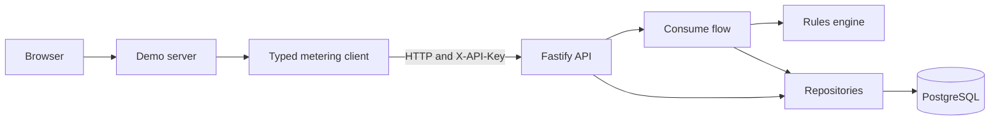
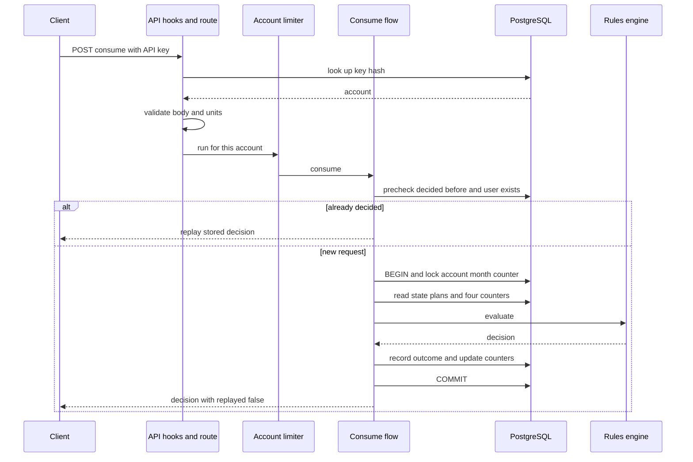
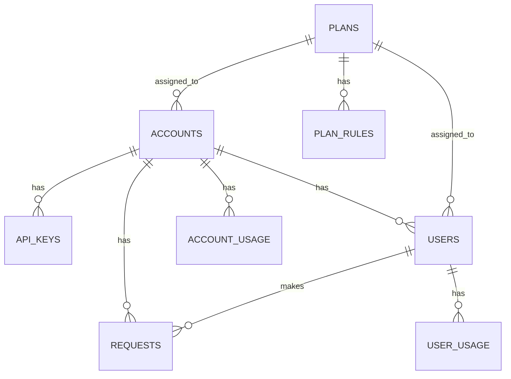
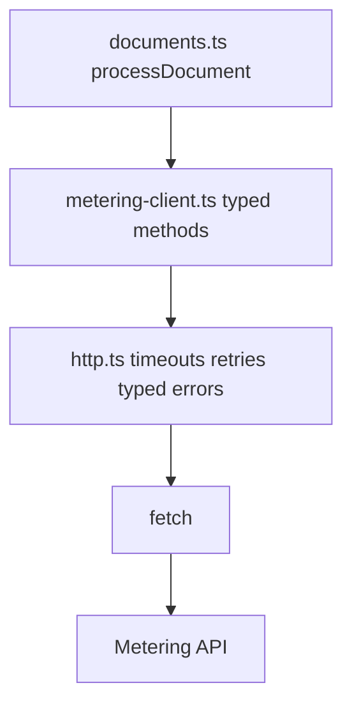
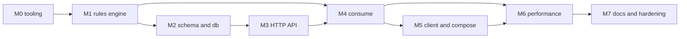

# Usage Metering Service: Project Walkthrough

> **Status:** Part 1 of 5. This part holds the glossary and sections 1 to 5 (overview, domain concepts,
> architecture, request lifecycle, database). Later parts add the milestone story (section 6), the deeper
> sections, and a final review.

## How to read this document

**Purpose.** This is a learning document for a backend developer who wants to understand the project well
enough to maintain it, debug it, extend it and explain it in an interview. It explains responsibilities,
data flow and reasoning. It does not explain the code line by line.

**Evidence labels.** The document was written from pasted terminal output, the original brief and plan, and code
drafted during development. It was not written by someone with access to the repository. Each claim therefore
carries one of three statuses (see the verification table at the end of each part):

| Status | Meaning |
|---|---|
| **Reported by owner** | The project owner pasted the output or said it passed |
| **Expected from source** | Follows from code drafted during development; not run by the author of this document |
| **Not verified** | Evidence is missing |

Code described here was drafted in the development conversation. It counts as "Expected from source" only when
the owner's `git log -- <file>` shows no later change except formatting. Where a file changed again later, that is
said explicitly.

**Companion documents.**

| Document | Role |
|---|---|
| [README.md](../README.md) | Setup, API reference, rules, assumptions A1 to A24, limitations |
| [USER_GUIDE.md](USER_GUIDE.md) | How to run, operate and verify the application |
| [endpoints.md](endpoints.md) | Endpoint notes (being reconciled with the README) |
| [performance.md](performance.md) | Load-test method and results |
| [usage-metering-analysis-and-plan.md](usage-metering-analysis-and-plan.md) | The original analysis and milestone plan |
| [usage-metering-service-brief.md](usage-metering-service-brief.md) | The original brief |

**Plan versus implementation.** The original plan is the intention and the repository is the truth. Where they
differ, this document says so. What has been established so far is in
[section 3.6](#36-plan-versus-implementation-established-so-far).

## Glossary

| Term | Meaning in this project |
|---|---|
| **Account** | A calling application. Row in `accounts`. Has an account plan and an API key |
| **User** | A user of that application, registered under one account. Row in `users` |
| **`externalId`** | The caller's own identifier for a user. Unique within an account. The `consume` request field named `userId` carries this value |
| **Internal user id** | The UUID `users.id`. Used for foreign keys and counters. Never returned by the API |
| **Plan** | A named set of rules. Scope is `account` or `user`. Predefined plans are global and read-only; custom plans belong to one account |
| **Rule** | One limit inside a plan. Kinds: `max_per_request`, `monthly_allowance`, `daily_allowance` |
| **Unit** | The one metered resource: a whole number, for example one document page |
| **Request id** | The caller's idempotency key for one logical action. Unique per account |
| **Fingerprint** | A SHA-256 hash of the user and units of a request, used to detect a reused request id with a different payload |
| **Decision** | The outcome of a consume request: accepted or rejected, with the reason, the plans that applied and the remaining allowances. Stored as JSON on the request row |
| **Violation** | One rule that blocked a request: level, rule kind, limit, used, remaining, requested |
| **Headroom** | How many units one rule would still allow right now. The idea that makes all three rule kinds work the same way |
| **Counter** | A row in `account_usage` or `user_usage`: units used for one owner, one period kind (month or day) and one period start |
| **Period** | A UTC calendar month or UTC day |
| **Replay** | Answering a repeated request id with the stored decision instead of deciding again |
| **Account lock** | The row lock on the account's monthly counter row, held during a consume transaction |

---

## 1. Project overview

### 1.1 The problem

An application sells or limits access to a resource: pages of document processing, API calls, storage. It needs
one trustworthy place that answers **"may this user consume N units right now?"** and counts the units when the
answer is yes. Doing that inside every application is error-prone. Two requests arriving at the same moment can
both see "5 units left" and both succeed, and a network retry can count the same action twice.

### 1.2 What the service does and does not do

| The service does | The service does not |
|---|---|
| Check every applicable limit of the account plan and the user plan | Do the business work (the demo only simulates it) |
| Record every decision, accepted or rejected, in history | Bill, charge or refund |
| Count accepted units at the user level and the shared account level | Authenticate end users (the calling backend does that) |
| Make retries safe through a request id | Manage roles or permissions |
| Report what is left under each rule | Meter more than one resource |

**Authorizing usage is different from doing the work.** The calling application asks first, and does the real
work only after an accepted answer. The demo's `processDocument` (in `client/documents.ts`) follows this
pattern. One consequence is deliberate: if the work fails after an accepted decision, nothing in this service
gives the units back. The brief puts refunds out of scope.

### 1.3 Actors

| Actor | Role |
|---|---|
| Account | The company or application calling the service. Has an account plan and an API key |
| User | A user of that application, with a user plan |
| Plan | A set of limits assigned to an account or to users |
| Calling application | The account's backend. Authenticates with the API key and asks to consume units |
| Metering service | Decides, records and counts. The single source of truth for usage |
| Provisioning operator | Whoever holds `ADMIN_TOKEN` and creates accounts (assumption A1) |

### 1.4 Functional requirements (from the brief)

1. Create accounts with API keys, register users, assign or change their plans, and keep each account's data separate.
2. Provide predefined plans, and let accounts create and edit custom plans.
3. Consume units: accept the full amount only if every account and user rule allows it, and consume nothing on rejection.
4. Explain decisions: say which rule blocked a request and whether it belongs to the account or the user.
5. Show usage (consumed and remaining), previous months, and request history with pagination.
6. Keep everything in the database so it survives restarts.
7. Provide an example application and a Docker Compose setup that starts the whole stack.

### 1.5 Reliability and correctness requirements

- **All or nothing:** a request is counted in full or not at all, at both levels.
- **No overspending under concurrency:** simultaneous requests must never use more than an allowance.
- **Safe retries:** the same request id must never count twice.
- **Predictable plan changes:** new limits apply to new requests, usage is kept, history is never rewritten.
- **Isolation:** one account can never see or affect another.
- **Evidence of performance:** load tests, with the correctness of totals checked afterwards.

### 1.6 Out of scope

Billing, payments, refunds, multiple resource types, end-user login, role-based permissions and distributed
infrastructure (from the brief). The README's known limitations add more (no deletion, no key rotation endpoint, no
rate limiting).

### 1.7 The core idea, in a small example

A document-processing company has an account plan of 10,000 pages per month. Alice has a personal plan of 1,000.
Before processing a 10-page document for Alice, its backend sends the service the user, a request id and 10 units.
The service checks both plans, and if both allow it, subtracts 10 from Alice's remaining pages **and** 10 from the
company's. The backend then does the work. If the company's shared allowance were nearly used up, the service would
reject the request even though Alice personally has room.

---

## 2. Requirements and domain concepts

### 2.1 Accounts and API keys

An account is created by `POST /accounts`, which needs the `ADMIN_TOKEN` secret (assumption A1). The response contains
the API key once. A key looks like `mk_<8 hex>_<43 characters>` and carries 256 bits of randomness. Only its SHA-256 hash
is stored, in `api_keys`, so a leaked database does not leak working keys. Every other call sends the key in `X-API-Key`.
The key identifies the account, and the account id used by every query comes from the key, never from the URL or body.

### 2.2 Users and identifiers

A user has two identifiers. The caller chooses `externalId` (for example `alice`), and it is unique within one
account, so two accounts can each have an `alice`. The service keeps its own UUID for foreign keys. Only the
`externalId` is ever visible. Asking for another account's user returns the same `404 user_not_found` as asking for a
user that does not exist, so nothing leaks across accounts.

### 2.3 Plans: predefined and custom

| Plan | Scope | Monthly allowance | Max per request |
|---|---|---|---|
| Starter (default for new accounts) | account | 10,000 | 100 |
| Pro | account | 100,000 | 1,000 |
| Basic (default for new users) | user | 1,000 | 20 |
| Premium | user | 10,000 | 200 |

Predefined plans are created automatically at startup with fixed ids, are visible to every account, and cannot be
changed (the API answers 403, and a database trigger enforces it as well). Custom plans belong to one account, can be
edited, and may be shared by several users who still keep separate usage. A plan has a scope, so a user plan cannot be
assigned to an account.

### 2.4 Rules

| Rule kind | Meaning | Present in predefined plans |
|---|---|---|
| `monthly_allowance` | Total units in a UTC calendar month | yes |
| `max_per_request` | Largest amount in one request | yes |
| `daily_allowance` | Total units in a UTC day (the extra rule of assumption A19) | no, custom plans only |

A plan may have any subset, at most one rule per kind. A missing rule means no limit.

### 2.5 How a request is evaluated

Both plans must allow the full amount. Each rule answers one question: "how many units could I still allow?" (its
**headroom**).

| Rule kind | Headroom |
|---|---|
| `max_per_request` | the limit |
| `monthly_allowance` | `max(0, limit - used this month)` |
| `daily_allowance` | `max(0, limit - used today)` |

A rule is violated when `requested > headroom`. The `max(0, ...)` is what makes "allowance lowered below existing
usage" safe: remaining is zero, never negative. The engine collects every violation from both levels and orders them
(per-request, then daily, then monthly; the account before the user within one kind). The first is the **primary** reason.

**Example.** Account plan Starter (10,000 per month, 100 per request), Alice on Basic (1,000 per month, 20 per request).
The account has already used 9,995 units. Alice has used none.

| Request | Account headroom | Alice's headroom | Outcome |
|---|---|---|---|
| Alice, 10 units | min(100, 5) = 5 | min(20, 1,000) = 20 | **Rejected** by the **account** monthly allowance. Alice has plenty, but the shared allowance has 5 left |
| Alice, 25 units | min(100, 5) = 5 | min(20, 1,000) = 20 | **Rejected** with two violations: the account allowance and Alice's per-request limit. The first by the fixed order is the per-request limit of the **user** |
| Alice, 5 units | 5 | 20 | **Accepted** (exactly at the boundary) |

A user's remaining allowance and the account's remaining allowance are different numbers. Both are in every response
(`remaining.user` and `remaining.account`).

### 2.6 Accepted and rejected requests

| | Accepted | Rejected |
|---|---|---|
| Units counted | added to the user's usage and to the account's usage (month and day counters) | nothing |
| Recorded in history | yes | yes, with the reason |
| `remaining` in the answer | after subtracting the units | unchanged |
| HTTP status | 200 | **200** (a rule rejection is a normal answer, assumption A8) |

### 2.7 Idempotency and safe retries

The request id is the idempotency key. First time it is seen: decide and record. Same id and same payload:
return the stored decision with `replayed: true`, count nothing. Same id with a different user or amount:
`409 idempotency_conflict`. A replay returns the **original** decision, even a rejection, even if the plan changed
meanwhile (assumption A6). To be evaluated again under a new plan, send a new request id.

### 2.8 UTC periods and rollover

Months and days are UTC. One timestamp per request decides which period it counts toward, and the month is also stored on
the request row (migration 0002). Each new month and each new day has its own counter rows, so "usage starts at zero"
simply means "a new row". Previous months stay queryable, and history is kept forever.

### 2.9 Usage summaries and history

`GET /usage` and `GET /users/:externalId/usage` return consumed and remaining. Remaining is only shown for the current
month, because remaining against today's plan would mislead for a past month. `GET /history` lists decisions newest
first with a cursor.

### 2.10 Assumptions that shape the design

The README lists all of them (A1 to A24). These five explain most structural choices:

| # | Decision | Reason | Where it shows up |
|---|---|---|---|
| A6 | A retry replays the original stored decision | Retries must be predictable | The decision is stored as JSON on the request row |
| A8 | A rejection is HTTP 200 with `accepted: false` | A business outcome is not a client error | Clients branch on one field; 4xx and 5xx mean real errors |
| A9 | Violations are ordered per-request, daily, monthly, account before user | A stable `primary` reason | `RULE_ORDER` and `LEVEL_ORDER` in `evaluate.ts` |
| A13 | UTC, one timestamp per request, month stored on the request | No ambiguity at month boundaries, and testable with a fake clock | `periods.ts`, the injectable clock, `period_month` |
| A19 | The extra rule is a daily allowance | Shows rule composition cleanly | A third rule kind with the same shape |

---

## 3. Architecture and repository map

### 3.1 Technology

Versions are the declared ranges in `package.json` (Reported by owner). Installed versions can differ within a range.

| Area | Technology |
|---|---|
| Language | TypeScript `^6.0.3`, ESM modules, Node `>=22` |
| HTTP server | Fastify `^5.12.7` |
| Validation | zod `^3.25.76` |
| Database | PostgreSQL 16 (`postgres:16-alpine` in Compose), `pg` `^8.23.1`, raw SQL, no ORM |
| Tests | Vitest `^5.0.4` (reported as 5.0.4), `fast-check` `^4.10.2` |
| Quality | ESLint `^10.12.0`, `typescript-eslint` `^8.71.1`, Prettier `^3.9.10` |
| Tooling | `tsx` `^4.23.15`, Docker Compose, k6 (Docker image) |

### 3.2 High-level picture



*Diagram not rendered by the author; preview it before relying on it.*

### 3.3 Dependency rules

- `src/domain` is pure. It may import only `src/shared`. The ESLint config pasted by the owner forbids `pg`, `fastify`, `zod`,
  `node:*` and the db, http and consume folders, plus `Date.now()`, `Math.random()`, a zero-argument `new Date()` and classes
  inside that folder.
- `src/consume` uses the domain and the repositories and contains the consume flow.
- `src/http` calls consume and the repositories. Routes contain no business rules.
- `src/db` is raw SQL behind small functions. It also imports a few types from `src/consume/types.ts`, so there is a type-only
  cycle between `db` and `consume` (types vanish at runtime).
- `client/` talks to the service **only over HTTP**. It borrows two tiny helpers (`Result`, `assertNever`) from `src/shared`.

### 3.4 Repository map

Paths come from the owner's `git ls-files`. Descriptions of internals come from code drafted during development;
files changed after that draft are noted.

| Directory or file | Responsibility | Why it exists | Main relationships |
|---|---|---|---|
| `src/shared/` (`result.ts`, `pipe.ts`, `assert-never.ts`, `fp.test.ts`) | `Result` type, left-to-right `pipe`, exhaustiveness helper | Expected failures become values; adding a union case breaks the build where it is unhandled | Used by domain, consume, db, http and client |
| `src/domain/` (`types.ts`, `units.ts`, `periods.ts`, `rules.ts`, `evaluate.ts`, `usage.ts`, `index.ts`) | The pure rules engine: plan, usage and request in, decision out | Correctness lives in one place that needs no database to test | Imports only `shared`; used by `consume` and `db` |
| `src/consume/` (`consume.ts`, `decision.ts`, `fingerprint.ts`, `usage-view.ts`, `types.ts`, `keyed-limiter.ts`) | The consume flow (the imperative shell around the engine), stored-decision and usage-view builders, the per-account limiter | Orchestrates I/O around a pure decision | Called by `http/routes/consume.ts`; calls `domain` and `db` |
| `src/db/` (`client.ts`, `migrate.ts`, `bootstrap.ts`, `seed.ts`, `predefined-plans.ts`, `cli.ts`, `errors.ts`, `plans.ts`, `accounts.ts`, `users.ts`, `usage.ts`, `effective-plans.ts`, `requests.ts`, `consume-state.ts`) | Pool and transaction helper, migration runner, seed, repositories | Keeps SQL out of routes and out of the domain | Used by `http` and `consume`; talks to PostgreSQL |
| `migrations/` (`0001_init.sql`, `0002_requests_period.sql`) | The schema, as numbered SQL files | Schema changes are versioned and checksummed | Applied at startup by `db/migrate.ts` |
| `src/http/` (`app.ts`, `deps.ts`, `auth.ts`, `api-keys.ts`, `validation.ts`, `errors.ts`, `dto.ts`, `cursor.ts`, `routes/admin.ts`, `routes/account.ts`, `routes/consume.ts`) | Fastify application: hooks for authentication, zod validation, one error format, DTOs, routes | The only layer that knows about HTTP | Calls `consume` and `db` |
| `src/config.ts`, `src/index.ts` | Environment validation, and the entry point (migrate, seed, listen, shut down) | Fail fast on bad configuration | Builds the pool and the app |
| `client/` (`config.ts`, `schemas.ts`, `http.ts`, `metering-client.ts`, `provisioning.ts`, `documents.ts`, `scenario.ts`, `server.ts`, `index.ts`, `cli.ts`, `web/page.ts`, `Dockerfile`) | The example application: typed HTTP client with timeouts and safe retries, scripted scenario, web page, CLI | Shows the service used by a real caller | Calls the API only over HTTP |
| Unit tests beside code (`src/**/*.test.ts`) | Domain, consume builders, shared helpers, configuration | Fast checks with no database | Mirror the pure modules |
| `tests/db/`, `tests/http/`, `tests/client/`, `tests/e2e/`, `tests/load/`, `tests/helpers/`, `tests/smoke.test.ts` | Database, API, client, end-to-end and verifier tests, plus shared helpers | Layered confidence (see section 8, Part 4) | `helpers/test-db.ts` and `helpers/test-app.ts` give each test file an isolated schema and app |
| `load-tests/` (`lib.js`, five scenarios, `verify.ts`, `sql/diagnose.sql`) and `scripts/` (`smoke.sh`, `load.sh`) | k6 scenarios, the post-run consistency verifier, diagnostics, runner scripts | Performance evidence that also checks correctness | Runs against the Compose stack |
| `Dockerfile`, `client/Dockerfile`, `docker-compose.yml`, `docker-compose.perf.yml`, `.dockerignore`, `.env.example` | Images and stacks. The perf overlay adds statistics and k6 | One command starts everything | The `service` image carries `migrations/` |
| `package.json`, `tsconfig.json`, `tsconfig.build.json`, `vitest.config.ts`, `eslint.config.mjs`, `.prettierignore` | Scripts and tooling | Strict types, tests, lint, formatting | Used by every directory |
| `docs/` | Brief, plan, README companions, `Schema.png` (contents not supplied), this walkthrough, the user guide | Explain, verify, hand over | Link to each other |

Compiled `.js` files appear beside some TypeScript sources in the file list (for example under `src/domain/`).
They look like stray build output and are not part of the architecture; Part 5 returns to this.

### 3.5 Why the layers are split this way

- **Domain apart from I/O.** The most important logic (is this request allowed?) can be tested with no database, in
  milliseconds, with thousands of generated inputs (property tests).
- **SQL in `src/db`, not in routes.** Routes stay about HTTP, and transaction logic stays about data.
- **The consume flow is its own folder.** It needs the domain, the database and a transaction, so it belongs
  neither to the pure core nor to the HTTP layer.
- **The client is separate and HTTP-only.** It proves the API is usable from outside and gives the demo something real to call.

### 3.6 Plan versus implementation (established so far)

| Topic | Original plan | What the evidence shows | Source |
|---|---|---|---|
| M0 | Branch `chore/m0-scaffold`, six small commits, tag `v0.0-scaffold` | One first commit, `5fefc2b` "init the project structure."; no M0 branch or tag in the pasted output | Reported by owner |
| M1 | Branch `feat/m1-rules-engine`, tag `v0.1-engine` | M1 commits (`9ea61c9` to `d029a6b`) sit directly on `main` | Reported by owner |
| M2 | `feat/m2-sql-schema`, tag `v0.2-schema` | Matches | Reported by owner |
| M3 | `feat/m3-http-api`, tag `v0.3-http` | Branch `feat/http-api`; tag `v0.3-http` | Reported by owner |
| Request period | Not in the initial schema | `0002_requests_period.sql`, commit `fad064c`, on `main` between M3 and M4 | Reported by owner |
| M4 | `feat/m4-consume-and-usage` | Branch `feat/consume-and-usage`, merge `64903d5`, no tag | Reported by owner |
| M5 | `feat/m5-client-and-compose` | Branch `feat/client-and-compose`, merge `0171b2d`; the tag `perf-baseline` sits on that merge | Reported by owner |
| M6 | Separate commits for fewer round trips and for the limiter; branch and tag | Linear commits on `main`. The new `consume.ts`, `consume-state.ts`, the limiter and `docker-compose.perf.yml` all arrive in commit `986ebde`. A `feat/load-testing` branch holds equivalent commits that were never merged | Reported by owner (file histories) |
| M7 | Branch `docs/m7-readme-and-review`, tag `v1.0` | Branch `docs/readme-and-review`, merge `1a5fa2c`; one commit `71542f3`; no `v1.0` tag in the pasted tags | Reported by owner |
| Locking | Lock account and user counters in a fixed order | One lock: the account's monthly counter row (section 4) | Expected from source |
| Lint rules | Purity rules from M0 | `eslint.config.mjs` changed in `71542f3`; the pasted file contains the purity rules | Reported by owner |
| Tool versions | Initial assumptions (TypeScript 5, Vitest 2) | `package.json` declares TypeScript `^6.0.3`, Vitest `^5.0.4`, ESLint `^10.12.0` | Reported by owner |

The pasted `package.json` declares `@types/node ^26.6.5` while `engines` requires Node `>=22`.

---

## 4. End-to-end request lifecycle

This is the **current** flow, after the M6 changes (M4 first wrote it; M6 rewrote `consume.ts` and added
`consume-state.ts` and the limiter). The M4 history is in Part 3.

### 4.1 One request, step by step

A client sends `POST /consume` with `{ "userId": "alice", "requestId": "order-1001", "units": 10 }`.

| # | Where | What happens | Why here |
|---|---|---|---|
| 1 | `client/documents.ts`, `metering-client.ts`, `http.ts` | The caller builds the request. The request id is chosen **once**, then `fetch` sends it with `X-API-Key` and a timeout | A retry must reuse the same id for idempotency to work |
| 2 | `src/http/auth.ts` (`onRequest` hook) | The key is hashed (SHA-256), looked up in `api_keys` joined to `accounts` (not revoked), and the account is attached to the request. Missing key is 401, unknown key is 401 | Authentication runs **before the body is parsed**, so an unauthenticated caller cannot make the server parse JSON |
| 3 | `src/http/routes/consume.ts`, `validation.ts` | zod checks the body (`userId` and `requestId` are non-empty strings, `units` a number). `parseUnits` requires a positive whole number up to 1,000,000,000. Failure is 400 `validation_error` | Everything past this point works with typed, valid values |
| 4 | `consume.ts` via `keyed-limiter.ts` | The call waits for a slot for this account (default 2 in flight per account per process, `ACCOUNT_CONCURRENCY`) | Requests waiting for a busy account wait in memory instead of holding database connections |
| 5 | `consume-state.ts` (`precheck`) | One lock-free query: has this request id been decided before (fingerprint and stored decision), and does this user exist in this account? Existing and same fingerprint: **replay**. Existing and different fingerprint: 409. User missing: 404 | Retries and unknown users get a cheap answer with no locks |
| 6 | `consume-state.ts` (`lockAccountForConsume`) | `BEGIN`, then lock the account's monthly counter row (`FOR UPDATE`). Only the first request of a month creates that row, then locks it | The shared allowance forces account-level serialization anyway, and one lock means no deadlocks |
| 7 | `consume-state.ts` (`loadConsumeState`) | **One statement, started after the lock:** any decision for this request id, the user's internal id, both plans with their rules, and the four counters (account and user, month and day) | Started after the lock, so it sees what the previous lock holder committed |
| 8 | `consume.ts` | If a decision for this id appeared while waiting for the lock, replay it (or 409) | The second idempotency check closes the race with a concurrent duplicate |
| 9 | `src/domain/evaluate.ts` | **The pure engine** evaluates the request against both plans and usage and returns accepted, or rejected with every violation | The decision needs no I/O |
| 10 | `consume/decision.ts` | Builds the stored decision: reason, the plans that applied, remaining allowances **after** the decision | A pure function, tested alone |
| 11 | `consume-state.ts` (`recordOutcome`) | **One statement:** insert the request row (with the whole decision as JSON and the month); **only if accepted**, add the units to the account's and the user's month and day counters | A rejection changes no counter, and the writes commit or fail together |
| 12 | `consume.ts` | `COMMIT`, which releases the account lock | The lock is held for about three statements and the commit |
| 13 | `routes/consume.ts` | The decision is returned as JSON with `replayed: false`. Errors map to the standard error shape | |
| 14 | Client | The typed client parses the response with zod. Transient failures (network, timeout, 429, 5xx) are retried with the **same** request id | A retry after a lost response lands on step 5 and is replayed |

The timestamp used for the month and day periods is taken once in the route handler (before waiting for the
limiter) and passed down, so one request has exactly one notion of "now".

The key statement ordering, as drafted in `src/db/consume-state.ts` (a comment in the code explains why):

```sql
-- statement 1: take the lock (its own statement on purpose)
SELECT 1 FROM account_usage
WHERE account_id = $1 AND period_kind = 'month' AND period_start = $2::date
FOR UPDATE;
-- statement 2 (starts AFTER the lock is held): read request, plans, counters in one query
-- statement 3: record the request and update counters in one query (data-modifying CTEs)
```

**Why the lock is its own statement.** In PostgreSQL's default `READ COMMITTED` level, a statement sees the data as of the
moment it **starts**. If the lock and the reads were one statement, the reads would use a snapshot taken before waiting for the
lock, and would miss the previous holder's commit, which could silently overspend. Starting the read statement after the lock
gives it a fresh snapshot.

### 4.2 The sequence



*Diagram not rendered by the author; preview it before relying on it.*

### 4.3 Error paths

| Situation | Where it is detected | Result |
|---|---|---|
| Missing or invalid API key | auth hook | 401 `missing_api_key` or `invalid_api_key` |
| Invalid body or units | zod and `parseUnits` | 400 `validation_error` with details |
| Unknown user, or another account's user | `precheck` | 404 `user_not_found` (identical for both) |
| Request id reused with a different payload | `precheck`, or the check after the lock | 409 `idempotency_conflict` |
| Limit exceeded | the rules engine | **200** with `accepted: false` and the reason |
| Unexpected failure | the error handler | 500 `internal_error`, no internal details |
| Client cannot reach the service | `client/http.ts` | typed `network` or `timeout` error, retried with backoff for retry-safe calls |

### 4.4 How a retry is handled

- **The first attempt committed but the response was lost:** the retry reaches step 5, finds the stored decision, and
  replays it with `replayed: true`. Nothing is counted again. An automated end-to-end test drops a response on purpose to
  show this.
- **Many identical requests at once:** they serialize on the account lock. Exactly one is decided; the others find it
  in step 8 and replay it. A concurrency test sends 25 identical requests.
- **The last guard:** a unique constraint on `(account_id, request_id)`. In the drafted code the account lock is what
  prevents two inserts of the same id. No code path converts a unique violation into a replay.

### 4.5 Conceptual order versus verified order

The 14 steps above describe the **drafted** M6 implementation. The files `consume.ts` and `consume-state.ts` were last
changed by commit `986ebde` according to the owner's file history, but their contents were not pasted. `keyed-limiter.ts`
and `routes/consume.ts` were changed again by `71542f3` (contents unknown). Treat the ordering as Expected from source until
a spot-check of those files confirms it.

---

## 5. Database design and persistence

Everything below comes from `0001_init.sql` and `0002_requests_period.sql` as drafted. The owner's file histories show each
file was committed once (`18eec6c` and `fad064c`) and never changed afterwards. The migration runner also creates
`schema_migrations`.

### 5.1 Tables and relationships



*Diagram not rendered by the author. `docs/Schema.png` is tracked, but its contents were not supplied, so no claim is made about it.*

| Table | What it stores and why | Important constraints | Read or written by |
|---|---|---|---|
| `plans` | Plan name and scope. `owner_account_id` is null for predefined plans | `scope` is `account` or `user`. Unique `(id, scope)`, unique `(owner_account_id, name)`, and a partial unique index on `name` where `owner_account_id IS NULL` (a plain unique treats NULLs as distinct). A trigger blocks UPDATE and DELETE on predefined plans | Seed at startup; `db/plans.ts` for custom plans |
| `plan_rules` | One row per rule: `kind` and `limit_value` | Primary key `(plan_id, kind)` (at most one rule per kind). `limit_value` between 0 and 10^12. A trigger blocks changes to rules of predefined plans | `db/plans.ts`, `effective-plans.ts`, `consume-state.ts` |
| `accounts` | The calling application and its plan | A composite foreign key `(plan_id, plan_scope)` to `plans(id, scope)`, where `plan_scope` is fixed to `account`, so a user plan **cannot** be assigned to an account | `db/accounts.ts` |
| `api_keys` | Key prefix and **SHA-256 hash** (never the key), optional `revoked_at` | `key_hash` unique and exactly 64 lowercase hex characters | Written when an account is created; read by the auth hook |
| `users` | A user inside an account, with `external_id` and a plan | Unique `(account_id, external_id)`. Unique `(id, account_id)` (so other tables can reference both). A composite foreign key makes user plans have scope `user` | `db/users.ts` |
| `account_usage` | One counter per account, period kind (`month` or `day`) and period start | Primary key `(account_id, period_kind, period_start)`. `units_used >= 0`. A month must start on day 1 | Written by the consume statements; read for usage and decisions |
| `user_usage` | The same, per user | Same shape | Same |
| `requests` | The history and the idempotency record. Holds the units, a fingerprint, the outcome, the whole decision as `jsonb`, `created_at`, and (since 0002) `period_month` | Unique `(account_id, request_id)`. A composite foreign key `(user_id, account_id)` to `users(id, account_id)`, so a request can never point to another account's user. `units > 0` | Written by `recordOutcome`; read by `precheck`, the state read, and history |
| `schema_migrations` | Which migrations were applied, with checksums | Primary key `version` | `db/migrate.ts` only |

Indexes beyond primary keys and unique constraints: `api_keys(account_id)`, `users(plan_id)`, and three on `requests`:
`(account_id, created_at DESC, id DESC)` and `(user_id, created_at DESC, id DESC)` for history, and
`(account_id, period_month, created_at DESC, id DESC)` for filtering by month (added in 0002).

### 5.2 What each mechanism prevents

| Mechanism | Problem it prevents |
|---|---|
| Composite foreign keys `(plan_id, scope)` | Assigning a user plan to an account or an account plan to a user, even through a buggy query |
| Composite foreign key on `requests (user_id, account_id)` | A request recorded for another account's user |
| Unique `(account_id, request_id)` | The same request id being recorded twice |
| `CHECK units_used >= 0`, month starts on day 1 | Corrupt counters |
| Triggers on `plans` and `plan_rules` | Editing or deleting a predefined plan, even by a direct SQL statement |
| Row lock on the account's monthly counter (`FOR UPDATE`) | Two concurrent requests both seeing "5 left" and both succeeding |
| `INSERT ... ON CONFLICT DO NOTHING` for the first counter row | Two first-of-the-month requests racing to create the same row |
| `INSERT ... ON CONFLICT DO UPDATE SET units_used = units_used + ...` | Lost updates, and the need to know whether a counter row exists yet |
| Migration checksums and an advisory lock | Editing an applied migration, and two starting instances migrating at once |

### 5.3 Migrations and seeding

- **`0001_init.sql`** creates the tables, constraints, indexes and read-only triggers described above.
- **`0002_requests_period.sql`** adds `requests.period_month`, with a check that it is a month start and an index. It was a
  new migration, not an edit of 0001, because 0001 had already been applied and checksummed. It exists because history must be
  filterable by month without depending on timestamps or the session time zone, and because the post-run consistency check compares
  per-month totals from the counter, the user totals and the accepted requests. The column has a default so rows inserted outside
  the service (such as in schema constraint tests) stay valid. The service always sets it explicitly from the same timestamp
  as the counters.
- **The runner** (`src/db/migrate.ts`) reads `NNNN_name.sql` files in order, applies each unapplied one in its own transaction,
  and records a checksum. It stops if an already-applied file changed.
- **The seed** (`src/db/seed.ts`, `predefined-plans.ts`) inserts the four predefined plans with fixed UUIDs using
  `ON CONFLICT DO NOTHING`, so it can run at every startup and never changes a plan.
- **Startup:** `src/index.ts` runs the migrations and the seed, then starts listening. The same function backs `npm run db:setup`.

### 5.4 Transactions, aggregation and pagination

- **Transactions.** `withTransaction` (in `db/client.ts`) runs a function on one connection with `BEGIN` and `COMMIT`, and
  rolls back on an exception. The consume transaction uses its **own** client and never the pool inside it, so a pile of
  waiting transactions cannot exhaust the pool.
- **Usage aggregation.** The service does not sum history to find usage. The four counters are read directly, and an
  absent row means zero. A consistency check (and a test helper) proves that the account counter, the sum of its users'
  counters and the sum of accepted requests agree.
- **History pagination** is keyset pagination on `(created_at, id)`. The next page is `WHERE (created_at, id) < (cursor)`,
  which matches the index. The cursor carries the timestamp as PostgreSQL text, because JavaScript dates drop microseconds
  and could skip or repeat rows at page boundaries.
- **`bigint` handling.** PostgreSQL returns `bigint` as a string in `pg`. The client module installs a parser that converts it
  to a number, which is safe here because every `bigint` column is bounded far below the safe integer limit.

### 5.5 What survives a restart

| Survives | Does not survive |
|---|---|
| Accounts, API key hashes, plans, users, counters, history (in the PostgreSQL volume) | The demo page's session (kept in memory by the `client` container) |
| Applied migrations and their checksums | The in-process account limiter's queue |
| | Requests being processed at the moment the service stops |

`docker compose down` keeps the volume. `docker compose down -v` deletes it. A restarted service migrates (a no-op),
seeds (a no-op) and serves the same data. Whether an older M4-era helper in `src/db` (such as separate request and usage
helpers replaced in M6) was removed in M7 is not established by the supplied evidence.

---

## Part 1 verification status

| Claim or check | Evidence | Status |
|---|---|---|
| 27 test files and 199 tests passed | Owner's pasted Vitest summary | Reported by owner |
| `format`, `lint` and `typecheck` clean | Owner's pasted output at the end of the client milestone; not re-reported since | Reported by owner (earlier point in time) |
| Containers healthy, smoke test passed, `{"status":"ready"}` | Owner's "all pass"; individual outputs not pasted | Reported by owner (summary only) |
| Branches, tags and commit history in section 3.6 | Owner's pasted `git branch -a`, `git tag -n`, `git log --graph` | Reported by owner |
| Package versions in section 3.1 | Owner's pasted `package.json` (declared ranges) | Reported by owner |
| Repository paths in section 3.4 | Owner's pasted `git ls-files` | Reported by owner |
| Purity rules present in `eslint.config.mjs` | Owner's pasted file | Reported by owner |
| That the purity rules actually fire | Not reported | Not verified |
| Schema, constraints, indexes, triggers in section 5 | Drafted `0001` and `0002`; file histories show one commit each | Expected from source |
| The 14-step consume flow in section 4 | Drafted M6 code; `consume.ts` and `consume-state.ts` last changed in `986ebde`, contents not pasted | Expected from source |
| `keyed-limiter.ts` default concurrency is 2 | Owner's `grep` output | Reported by owner |
| Current behavior of `keyed-limiter.ts` and `routes/consume.ts` | Changed again in `71542f3`, contents unknown | Not verified |
| README anchors used in links (for example `#api-reference`) | README not pasted | Not verified |
| Mermaid diagrams render | Not rendered | Not verified |
| Contents of `docs/Schema.png` | Not supplied | Not verified |
| Whether the M7 cleanup of old helper functions was applied | Not supplied | Not verified |
## 6. The development story: milestones M0 to M7 (part 1: M0 to M3)

### 6.0 How the story is told

The original plan ([usage-metering-analysis-and-plan.md](usage-metering-analysis-and-plan.md)) defined eight milestones.
The commits do not carry milestone labels, so **the grouping below is reconstructed** from commit order and from which
commits touched which files. The commits, file names and numbers are real (from the owner's pasted Git output).
Every milestone uses the same structure:

| Part | Question it answers |
|---|---|
| A. Goal | What problem did this milestone solve? |
| B. Why it mattered | What was impossible, unsafe or incomplete without it? |
| C. Implementation map | Which files, owning what, connected to what? |
| D. Key engineering decisions | Which choices, and what did they cost? |
| E. How it works | The most important execution path |
| F. Verification and learning | Which tests exist, what they prove and what they do not |
| G. Plan versus implementation | Where the repository differs from the plan |
| H. What you should be able to explain | Interview questions |

Later changes to a milestone's files are listed under C or G, because later work rewrote some early files.

| Milestone | Actual Git line | Merge and tag |
|---|---|---|
| M0 | First commit `5fefc2b` on `main` | none |
| M1 | Commits `9ea61c9` to `d029a6b`, directly on `main` | none |
| M2 | Branch `feat/m2-sql-schema` (`18eec6c` to `6d1a81a`) | Merge `1126699`, tag `v0.2-schema` |
| M3 | Branch `feat/http-api` (`62c6f7f` to `45b41a8`) | Merge `d0a8ec2`, tag `v0.3-http` |

M4 to M7 follow in Part 3.

---

### 6.1 M0: Foundation

**A. Goal.** A project that compiles, tests and lints before any feature exists.

**B. Why it mattered.** Without a working toolchain, every later bug is ambiguous: is it the feature or the setup? A green
`typecheck`, `lint` and `test` loop from day one gives each later step a way to say "this works".

**C. Implementation map.** All of it arrived in the first commit, `5fefc2b` (12 files).

| File | Responsibility | Connects to |
|---|---|---|
| `package.json`, `package-lock.json` | Scripts (`build`, `typecheck`, `lint`, `test`, `test:watch`), `"type": "module"`, `engines: node >=22`, and dev dependencies (TypeScript, Vitest, `fast-check`, ESLint, `typescript-eslint`, `@types/node`) | Everything. It lists no runtime dependencies yet |
| `tsconfig.json` | Compiler settings: target ES2022, `NodeNext` modules, `strict`, no emit, Node types. Includes `src`, `tests` and `vitest.config.ts` | The `typecheck` script |
| `tsconfig.build.json` | Extends the base config with emit turned on, for `src` and `client`, excluding tests | The `build` script and, later, the Dockerfiles |
| `vitest.config.ts` | Finds tests in `src`, `client` and `tests` | The `test` script |
| `eslint.config.mjs` | ESLint recommended rules plus `typescript-eslint` recommended; ignores `dist`, `node_modules`, `coverage` | The `lint` script. No domain-purity rules yet |
| `src/shared/assert-never.ts` | Exhaustiveness helper for discriminated unions | Used by the domain, db, http and client later |
| `tests/smoke.test.ts` | A one-line test that proves the runner works | `npm test` |
| `.env.example`, `.gitignore`, `docker-compose.yml` | Settings template, ignore rules, an **empty** placeholder compose file | The compose file gets real content in the M3 branch |

**D. Key engineering decisions.**

- **TypeScript `strict` and nothing stricter.** `strict` turns on null checks, no implicit `any` and related checks. The extra flags that would make
  array indexing return `T | undefined` or forbid explicit `undefined` in optional properties were not enabled. That is simpler, and it
  accepts a little more risk.
- **ES modules (`NodeNext`).** Relative imports must end in `.js` even though the source is `.ts`. It looks odd and is required by Node's ESM rules.
- **Vitest and `fast-check` from the start.** Property-based testing was planned for the rules engine, so the library was installed on day one.
- **`assertNever` in the foundation.** Adding a new case to a union then fails the build everywhere it is not handled. The version in the repository
  also carries a comment block explaining that the runtime exception makes invalid external data fail explicitly.

**E. How it works.** `npm run typecheck` runs `tsc --noEmit`, `npm run lint` runs ESLint, `npm test` runs Vitest once, and
`npm run build` compiles `src` and `client` with the build config. The usage pattern for `assertNever`:

```ts
switch (decision.kind) {
  case "accepted": return ...;
  case "rejected": return ...;
  default: return assertNever(decision);   // fails to compile if a new case is added and not handled
}
```

**F. Verification and learning.** `tests/smoke.test.ts` appears in the owner's pasted Vitest output as passing. There is no dedicated test for `assertNever`
in the file list. The smoke test proves only that the runner works, not any behavior. It demonstrates the idea of a **fast feedback loop**.

**G. Plan versus implementation.**

| Plan | Repository |
|---|---|
| Branch `chore/m0-scaffold`, about six small commits, tag `v0.0-scaffold` | One commit, `5fefc2b` "init the project structure.", and no branch or tag |
| `tsconfig` with extra strict flags | `strict` only |
| ESLint purity rules in M0 | Recommended rules only. Purity rules arrive in the M7 commit |
| Prettier and a format script | Not in M0. Prettier arrives in M3 (`a6e3ced`) |
| A compose file with PostgreSQL | An empty file. PostgreSQL arrives in `68e5dda` (M3) |
| A clean first commit | The first commit also contains a compiled `src/shared/assert-never.js` next to the `.ts` file. A `tsc` build had emitted JavaScript beside the sources, and it was committed by accident |

The `.js` files then repeat in several later commits (see 6.2 and 6.3). A "no giant initial commit" goal was not met, and that is worth being honest about in an interview:
small commits are what make history readable.

**H. What you should be able to explain.**

1. What does `strict: true` change, and what stricter options exist that this project did not turn on?
2. Why do imports end in `.js` in a TypeScript ESM project?
3. What problem does `assertNever` solve, and when does it fail: at compile time or at run time?
4. Why set up the test and lint loop before writing any feature?
5. What went wrong with the first commit, and how would you avoid it next time?

---

### 6.2 M1: The pure rules engine

**A. Goal.** A function that answers "is this request allowed?" given two plans, current usage and the request, with no database, no HTTP and no clock.

**B. Why it mattered.** The rules are the heart of the product. If they are mixed with SQL and routes, they cannot be tested exhaustively and
every change risks the database code. Isolating them lets thousands of generated inputs run in milliseconds, and keeps the later layers thin.

**C. Implementation map.** Commits made directly on `main`.

| Commit | Files | Responsibility |
|---|---|---|
| `9ea61c9` | `src/shared/result.ts`, `pipe.ts`, `fp.test.ts` | A success-or-failure `Result` type, a left-to-right `pipe`, and their tests |
| `624d72d` | `src/domain/types.ts`, `units.ts`, `units.test.ts` | The data model (`Plan`, `RuleConfig`, `UsageSnapshot`, `Decision`, `Violation`), the validated `Units` type, and `parseUnits` (positive whole number up to 1,000,000,000) |
| `a4388d6`, `07800df` | `src/domain/periods.ts`, `periods.test.ts` | UTC month and day period keys as pure functions of a `Date` |
| `44d95a5` | `src/domain/rules.ts` | Rule builders for per-request, monthly **and daily** limits, plus `headroom` and `remainingFor` |
| `af3f7b8` | `src/domain/evaluate.ts` | The decision function with deterministic violation ordering |
| `c391032` | `src/domain/evaluate.test.ts` | Examples from the brief, boundaries, ordering, plan changes |
| `d029a6b` | `src/domain/index.ts`, `evaluate.property.test.ts` | The public entry point, and four property-based tests |

Later changes: `src/domain/usage.ts` and its test arrive in M4 (`6bdfe2d`), and the purity lint rules in the M7 commit. The M1 sources themselves were only
reformatted afterwards (file histories show the Prettier commit `45b41a8` and nothing else).

**D. Key engineering decisions.**

| Decision | Why | Cost |
|---|---|---|
| **One idea for all rules: headroom** (`requested > headroom` means violated) | A per-request limit, a monthly allowance and a daily allowance all become "how much could I still allow?". A lowered allowance gives `max(0, ...)`, so remaining is never negative | A small abstraction to learn |
| The engine receives usage **already scoped** to the right month and day | It needs no clock, and tests need no time mocking | The caller must pick the right counters (the shell does, in M4) |
| Rules are functions built from plan data (`makeRule(level, config)`) | Composable, testable one at a time | |
| Violations are collected from **both** levels and ordered by a fixed rule | A stable `primary` reason, so the same request always explains itself the same way | The ordering is a product choice (assumption A9) |
| The extra rule, `daily_allowance`, is built in from the start | Demonstrates that a new rule kind is one more function, not a redesign | |
| `Units` is a validated type, not a bare `number` | A raw `number` cannot be passed where validated units are expected | A cast in one place (`parseUnits`) |
| A `Result` type for expected failures | Callers handle both outcomes explicitly | The discriminant field name needs checking (see below) |

**E. How it works.** The core of `headroomFor`, as drafted:

```ts
switch (kind) {
  case "max_per_request":   return limit;
  case "monthly_allowance": return Math.max(0, limit - usage.monthUsed);
  case "daily_allowance":   return Math.max(0, limit - usage.dayUsed);
  default: return assertNever(kind);
}
```

And `evaluate` is a pipeline of small steps:

```ts
const violations = pipe(
  levelsOf(context),                                        // account and user, each with plan and usage
  (entries) => entries.flatMap(({ level, plan, usage }) =>  // build rules and run each one
    buildRules(level, plan).map((rule) => rule({ requested: context.requested, usage }))),
  (results) => results.filter(isViolation),                 // keep only the failures
  (found) => found.toSorted(byPriority),                    // fixed order
);
return toDecision(context.requested, violations);           // accepted, or rejected with all violations
```

This is where the functional-programming ideas appear: pure functions, partial application (`makeRule`), `flatMap`, `filter`, `toSorted`,
`reduce` (inside `headroom`), and composition (`pipe`). Mutable state is absent. The excerpts are the drafted versions, and the file
histories show only formatting changes after them.

**F. Verification and learning.** From the owner's pasted test runs: `evaluate.test.ts` (15 tests), `evaluate.property.test.ts` (4),
`units.test.ts` (10), `periods.test.ts` (5) and `fp.test.ts` (5) all passed.

| Test group | What it proves | What it does not prove |
|---|---|---|
| The brief's examples (25 units rejected by the user per-request limit, 10 accepted, 10 rejected with 5 left at the account) | The rules do what the brief says | That the database layer feeds the engine correct usage |
| Boundaries, ordering, daily rule, lowering below usage | Exact edges and the fixed order | |
| Four properties: accepted exactly when both levels have headroom; deterministic and no mutation; every reported violation is short of the request; monotonic (if N units are accepted, fewer are too) | The rules hold across thousands of generated inputs | Concurrency, persistence, or HTTP behavior |
| Period tests (last millisecond of a month, year boundary, leap day) | UTC period keys are exact | Time zones of the machine are irrelevant, but that is not tested separately |

**Open point about `Result`.** The drafted `Result` used an `ok` flag. The pasted M7 diff shows `provisioned.type === "err"` in `client/cli.ts`
and `units.type !== "ok"` in `src/http/routes/consume.ts`, while `client/http.ts` (unchanged since M5) still uses `.ok`. The repository's
`src/shared/result.ts` therefore supports whatever fields those files use. Its exact shape has **not** been established here.

**G. Plan versus implementation.** The engine matches the plan. The M1 branch `feat/m1-rules-engine` and tag `v0.1-engine` do not exist: the commits sit
directly on `main`. The plan's lint rule that enforces "no I/O, no clock" was not active until the M7 commit, so for most of the project the purity was a
convention checked by review.

**H. What you should be able to explain.**

1. Why does `evaluate` take usage as an argument instead of reading the database, and what does that buy you?
2. What is headroom, and why does it make the lowered-allowance case need no special code?
3. Why are violations ordered, and what would break if the order changed between runs?
4. What does the monotonic property prove, and why can a property find bugs that hand-picked examples miss?
5. Why is the extra rule a good test of the design?

---

### 6.3 M2: SQL schema, migrations and seeding

**A. Goal.** A database that stores accounts, plans, usage and history, can be created from nothing by one command, and enforces as many rules as it can by itself.

**B. Why it mattered.** Until now nothing persisted. The brief requires data to survive restarts, and correctness under concurrency (M4) needs constraints and
transactions to exist first. Building the schema before the HTTP layer meant the API could be written against something tested.

**C. Implementation map.** Branch `feat/m2-sql-schema`, merged by `1126699`, tag `v0.2-schema`.

| Commit | Files | Responsibility | Depends on |
|---|---|---|---|
| `18eec6c` | `migrations/0001_init.sql` | The whole schema: tables, constraints, indexes, the read-only triggers | PostgreSQL |
| `33696d9` | `src/db/client.ts` | Pool creation, the transaction helper (`withTransaction`), the `Queryable` type, and a parser that turns `bigint` into a number | `pg` |
| `7ff8ec2` | `src/db/migrate.ts`, `bootstrap.ts`, `seed.ts`, `predefined-plans.ts`, `cli.ts` | The migration runner, the idempotent seed of the four predefined plans, one function that does both, and a `db:setup` command | `client.ts`, the domain's types |
| `273ac7f` | `src/db/plans.ts` | The first repository: read plans with their rules, in the domain's shape | `client.ts` |
| `812fa60` | `tests/db/migrate.test.ts`, `tests/helpers/test-db.ts` | Runner tests, and the helper that gives every test file its own PostgreSQL schema | |
| `605914f` | `tests/db/seed.test.ts`, `constraints.test.ts` | Seed and schema tests | |
| `6d1a81a` | `src/db/cli.ts` | A small follow-up to the command-line entry | |

Later changes: `plans.ts` grew in M3; `migrations/0002_requests_period.sql` was added after M3 (`fad064c`); `tests/db/migrate.test.ts` was changed in that
commit to compute expected migrations from the files on disk.

**D. Key engineering decisions.**

| Decision | Problem it solves | Cost |
|---|---|---|
| **Raw SQL with `pg`, no ORM** | Full control of locks, `ON CONFLICT` and statements. SQL was one of the skills to practise | More code, no migration generator |
| **Composite foreign keys** `(plan_id, scope)` and `(user_id, account_id)` | The database itself refuses a user plan on an account, and a request for another account's user | Slightly unusual keys to understand |
| **Triggers on `plans` and `plan_rules`** | Predefined plans cannot be changed, even by a direct SQL statement | Logic in the database |
| **Counters keyed by owner and period, never by plan** | Switching plans can never reset usage, and past months remain | Two counter tables |
| **Numbered migration files with checksums, one transaction each, plus an advisory lock** | An applied migration cannot be silently edited, a failed one leaves nothing behind, and two starting instances cannot migrate at once | A runner to write and test |
| **Idempotent seed** (`INSERT ... ON CONFLICT DO NOTHING`, fixed UUIDs) | Safe to run at every startup, and it never overwrites a plan | A plan's limits cannot change by editing the constants: that needs a new migration |
| **A PostgreSQL schema per test file** | Test files run in parallel without touching each other or real data | A helper to maintain |

A fragment of the schema shows the style (as drafted in `0001`, unchanged since its one commit):

```sql
CREATE TABLE users (
  ...
  plan_id UUID NOT NULL,
  plan_scope TEXT NOT NULL DEFAULT 'user' CHECK (plan_scope = 'user'),
  UNIQUE (account_id, external_id),
  FOREIGN KEY (plan_id, plan_scope) REFERENCES plans (id, scope)   -- a user plan must have scope 'user'
);
```

**E. How it works.** At startup `bootstrapDatabase` runs `runMigrations` and then `seedPredefinedPlans`. The runner takes an advisory lock, creates
`schema_migrations` if needed, applies each unapplied numbered file in its own transaction, records its checksum, and refuses to continue if an
applied file's checksum no longer matches. In tests, `createTestDb` creates a schema named `test_<uuid>`, points the connection's `search_path` at it, runs
the same bootstrap, and drops the schema afterwards.

**F. Verification and learning.** The test files and their counts come from the owner's pasted runs: `migrate.test.ts` (5 tests, including idempotency,
checksum tampering and rollback of a failing migration), `seed.test.ts` (5), `constraints.test.ts` (12: plan scope, uniqueness, read-only triggers,
usage checks, request isolation, key hash format). The owner reported that all test files pass after fixing a local PostgreSQL port conflict (see the problems
section in Part 4).

What these tests prove: the schema rejects bad data, the runner is idempotent and safe, the seed is repeatable. What they do not prove:
behavior under concurrent load (M4 and M6) and the behavior of the HTTP layer.

**G. Plan versus implementation.** The runner, seed and bootstrap arrive together in one commit (`7ff8ec2`), not as separate commits as planned. The tag
`v0.2-schema` exists as planned. The migration `0002` that records the UTC period month on requests was not part of this milestone's schema.

**H. What you should be able to explain.**

1. Why are `(plan_id, scope)` and `(user_id, account_id)` composite foreign keys, and what bug does each prevent?
2. Why are usage counters keyed by owner and period instead of by plan?
3. What do the migration checksum and the advisory lock each protect against?
4. Why is the seed idempotent, and how would you change a predefined plan's limits?
5. Why does each test file get its own schema instead of its own database?

---

### 6.4 M3: The HTTP API

**A. Goal.** Expose accounts, users and plans through authenticated, validated HTTP endpoints with one error format.

**B. Why it mattered.** The rules and the schema were useless to any caller. The API is also where **account isolation** is enforced: this is the layer that turns
an API key into an account and makes every query scoped to it.

**C. Implementation map.** Branch `feat/http-api`, merged by `d0a8ec2`, tag `v0.3-http`.

| Commit | Files | Responsibility | Depends on |
|---|---|---|---|
| `62c6f7f` | `src/db/plans.ts` (extended), `errors.ts` | Custom plan create and update (atomic), plan visibility rules, assignable-plan lookup | M2's client and plan repository |
| `9ed2e76` | `src/db/accounts.ts`, `users.ts` | Account creation with its first API key in one transaction, key-hash lookup, user registration, cursor-paged user list | `client.ts` |
| `822adbd` | `src/config.ts`, `config.test.ts` | Environment variables validated with zod. A bad value stops the service at startup | zod |
| `76bd6f5` | `src/http/errors.ts`, `validation.ts`, `api-keys.ts`, `deps.ts` | One `AppError` and one error shape, the zod parsing helper, key generation and hashing, the dependency bundle | |
| `e132560` | `src/http/auth.ts` | Two `onRequest` hooks: the admin token (constant-time comparison) and the API key (hash lookup) | `api-keys.ts`, `db/accounts.ts` |
| `e75953a` | `src/http/dto.ts`, `routes/admin.ts` | Response shapes, and `POST /accounts` | |
| `2f6512d` | `src/http/routes/account.ts` | Account, user and plan endpoints | `db/*` |
| `96578f8` | `src/http/app.ts`, `src/index.ts` | `buildApp` (error handlers, health and readiness, route registration) and the entry point | |
| `0cb0fb7`, `5caf6bd` | `tests/helpers/test-app.ts`, `tests/http/*.test.ts` | API tests | M2's `test-db.ts` |
| `68e5dda` | `package.json`, `docker-compose.yml`, `docs/endpoints.md`, `config.ts`, `tsconfig.build.json`, `.gitignore` | Adds Fastify and zod, `dev` and `start` scripts, the first PostgreSQL compose file, and the API notes | |
| `a6e3ced`, `45b41a8` | `package.json`, `.prettierignore`, then 53 files | Adds Prettier, then formats the whole codebase in one commit | |

Later changes: `errors.ts` gained `idempotency_conflict` (M4), `deps.ts` gained the clock (M4) and the concurrency setting (M6), `app.ts` registered the consume
routes (M4), and `config.ts` and `index.ts` gained pool and limiter settings (M6).

**D. Key engineering decisions.**

| Decision | Problem it solves | Cost |
|---|---|---|
| **Authentication in an `onRequest` hook** | The key is checked before the body is parsed, so an unauthenticated caller cannot make the server parse JSON, and a bad body cannot hide a missing key | |
| **Keys are hashed (SHA-256) and looked up by hash** | No secret is compared in application code, and a leaked database does not leak working keys | The key can be shown only once |
| **The admin token is compared in constant time** | Avoids leaking how many characters matched | One shared provisioning secret instead of roles |
| **The account id comes only from the key** | Isolation: every repository function takes `accountId`, so there is no query that can reach another account | Discipline in every new query |
| **404 for another account's resource, identical to "not found"** | Nothing leaks across accounts | A reader cannot tell "missing" from "not yours" |
| **zod at the boundary** | Code past it works with typed, valid values. Types are inferred from the schemas | |
| **`Result` values in repositories, thrown `AppError` in routes** | Expected outcomes (duplicate, not found) are values. The route turns them into one HTTP error in one place | Two styles to understand |
| **DTOs separate from database rows** | Internal ids never leave the service, and the API shape can stay stable | A mapping layer |
| **`buildApp(deps)` takes the pool and settings as parameters** | Tests build an app on an isolated schema and call it with `app.inject`, with no network port | |
| **Plan updates lock the plan row and replace its rules in one transaction** | A reader never sees half a plan | A short lock |

**E. How it works.** Take `POST /users`. The auth hook hashes `X-API-Key`, finds the account, and attaches it to the request. The route parses the
body with zod, asks `findAssignablePlan` for a plan this account may see with scope `user` (a foreign or missing plan gives 404, a wrong scope gives 422),
calls `createUser`, which returns a `Result` (a duplicate `externalId` becomes 409), and shapes the answer with a DTO. Any thrown `AppError` goes to one
error handler, which writes `{ "error": { "code", "message", "details"? } }`.

**F. Verification and learning.** From the owner's pasted runs: `auth.test.ts` (10 tests), `accounts.test.ts` (7), `isolation.test.ts` (6), `plans.test.ts` (16),
`users.test.ts` (8) and `config.test.ts` (4). They cover missing, blank, unknown and revoked keys, that only a hash is stored, admin protection,
account isolation for users and plans, predefined plans being read-only, plan scope checks, validation errors and cursor pagination.
They prove the API behaves as documented against a real database. They do not prove consume behavior (M4), and an HTTP test on `app.inject` does not prove that
the network, Docker or the browser work.

**G. Plan versus implementation.**

- The branch is `feat/http-api` (planned `feat/m3-http-api`). The tag `v0.3-http` matches.
- **Dependencies arrived late.** The M0 `package.json` lists neither Fastify, zod nor `pg`. Fastify and zod appear in `68e5dda`, after the code that
  imports them. Commits before it that import zod or Fastify could not have compiled on their own. This is an inference from the M0 file; the
  M2 `pg` dependency commit was not shown.
- **Prettier arrived in M3**, so one commit (`45b41a8`) rewrote 53 files (about 3,800 lines changed). That is why history for early files is dominated by
  a formatting commit, and why `git blame` is less useful. Setting up formatting in M0 would have avoided it.
- `docs/endpoints.md` was written in this milestone. It covers only the M3 endpoints and disagrees with the code in several places (for example it says
  `/health` returns 503, uses 422 for validation errors, and omits `X-Admin-Token`). It is to be reconciled in Part 5.

**H. What you should be able to explain.**

1. Walk through how an API key becomes an account, and why the account id never comes from the URL or body.
2. Why does an unknown user and another account's user return the same 404?
3. Why is the key hashed, and why is the admin token compared differently?
4. Why do repositories return `Result` while routes throw `AppError`?
5. Why does `buildApp` receive its dependencies instead of creating them?
6. What did the Prettier commit teach you about when to set up tooling?

---

## Part 2 verification status

| Claim or check | Evidence | Status |
|---|---|---|
| Contents of the 12 M0 files and the M0 `tsconfig`, ESLint and `package.json` | Owner's pasted `git show 5fefc2b:<file>` | Reported by owner |
| Which commits touched which source files (M1 to M3 mappings) | Owner's pasted per-file `git log` | Reported by owner |
| Branch, merge and tag facts in 6.0 | Owner's pasted `git log --graph` and `git tag -n` | Reported by owner |
| Test counts per file and that the suite passed | Owner's pasted runs and "27 files, 199 tests" | Reported by owner |
| `docs/endpoints.md` content and its gaps | Owner pasted the file | Reported by owner |
| Behavior and excerpts of the rules engine | Drafted code; file histories show formatting as the only later change | Expected from source |
| Schema, triggers and runner behavior | Drafted `0001` and the db files; file histories show no later edits except formatting | Expected from source |
| HTTP behavior in 6.4 (hooks, error flow) | Drafted code, changed later only by formatting and the M4 and M6 edits noted | Expected from source |
| Shape of `src/shared/result.ts` (`ok` versus `type`) | Conflicting usage in pasted diffs; file not pasted | Not verified |
| `typecheck` does not directly check `client/server.ts`, `cli.ts`, `index.ts`, `web/page.ts` | Inferred from the M0 `tsconfig.json` include list | Not verified |
| Commits before `68e5dda` do not compile in isolation | Inferred from the M0 `package.json` | Not verified |
| Whether the stray `.js` files equal current compiled output | Inferred from unchanged sources | Not verified |
## 6. The development story (continued): M4 to M7

The grouping is **reconstructed**, as explained in section 6.0. Commits, file names and numbers come from the owner's pasted
Git output.

| Milestone | Actual Git line | Merge and tag |
|---|---|---|
| M4 | `fad064c` on `main`, then branch `feat/consume-and-usage` (`6bdfe2d` to `2c77441`) | Merge `64903d5`, no tag |
| M5 | Branch `feat/client-and-compose` (`28b62c9` to `e72c27e`) | Merge `0171b2d`, tag `perf-baseline` (a lightweight tag: it shows the merge subject) |
| M6 | Linear commits on `main` (`986ebde`, then `5224d20` to `98ceb12`); a parallel branch `feat/load-testing` was never merged | No merge commit, no tag |
| M7 | Branch `docs/readme-and-review`, one commit `71542f3` | Merge `1a5fa2c`, no tag |

---

### 6.5 M4: Consumption, idempotency, usage and history

**A. Goal.** Connect the pieces into the product: `POST /consume` decides, counts and records; usage and history can be read back; a retry
is safe; concurrent requests cannot overspend.

**B. Why it mattered.** M1 could say yes or no, M2 could store data and M3 could authenticate callers, but nothing joined them. This milestone holds
the hardest requirements: counting all-or-nothing at two levels, retries, concurrency, and month rollover.

**C. Implementation map.**

| Commit | Files | Responsibility | Depends on |
|---|---|---|---|
| `fad064c` (on `main`, before the branch) | `migrations/0002_requests_period.sql`, `tests/db/migrate.test.ts` | Adds `requests.period_month`. The migration test now computes the expected versions from the files on disk | M2 runner |
| `6bdfe2d` | `src/domain/usage.ts`, `usage.test.ts` | `addUsage`, `emptyUsage` and `remainingSummary`, all pure | M1 rules |
| `a0311d9` | `src/consume/types.ts`, `fingerprint.ts` and its test | The shapes (`StoredDecision`, `ConsumeCommand`, and the error union) and a SHA-256 fingerprint of user and units | |
| `5b644c0` | `src/consume/decision.ts`, `usage-view.ts` and their tests | `buildStoredDecision` (decision plus context in, saved decision out), and the month and usage view builders | M1 engine |
| `893afdd` | `src/db/usage.ts`, `effective-plans.ts`, `requests.ts` | The M4-era data access: counters with the account lock, plans for a user, request lookup and insert, history | M2 client |
| `32dcacb` | `src/consume/consume.ts` | The transactional consume with idempotent replay (M4 version) | all of the above |
| `c649405` | `src/http/routes/consume.ts`, `cursor.ts`, `errors.ts`, `deps.ts`, `app.ts` | `POST /consume`, `GET /usage`, `GET /users/:externalId/usage`, `GET /history`; the opaque cursor; a new `idempotency_conflict` error; an injectable clock | M3 server |
| `0532fa0` | `tests/helpers/consistency.ts`, `test-app.ts`, `tests/http/consume.test.ts` | End-to-end behavior tests and a three-way totals check | |
| `daaf961` | `tests/http/consume-concurrency.test.ts` | Concurrency tests | |
| `2c77441` | 21 files | A sweep commit ("complete ...") that rewrote most M4 files nearly line for line | |

**Later changes.** M6 replaced `consume.ts` and added `consume-state.ts`. M7 deleted the M4 helpers that M6 left unused (`findRequest`,
`insertRequest`, `NewRequest`, `userExists`, `lockAccountMonth`, and the counter-update helpers). The pasted M7 diff confirms those names.

**D. Key engineering decisions.**

| Decision | Problem it solves | Cost or alternative |
|---|---|---|
| **One lock per account**: the account's monthly counter row, `FOR UPDATE`, held until commit | The shared allowance forces serialization per account anyway. One lock means no deadlocks, and different accounts never block each other | A hot account has a throughput ceiling. The plan proposed locking account and user counters in a fixed order |
| **Plans and counters are read after the lock** | A plan update committed while waiting is seen, and so is the previous holder's usage | Reads wait for the lock |
| **The decision is stored as JSON and replayed** | A retry answers identically, even if plans changed (assumption A6) | Old decisions are never recomputed |
| **A fingerprint of user and units** | The same request id with a different payload is a client bug, so it gets `409` | |
| **Idempotency checked three times**: before the transaction (cheap), inside it after the lock (race), and by a unique constraint (last guard) | Retries are fast, concurrent duplicates are safe, and the database is the final authority | |
| **An injectable clock; one timestamp per request** | Month and day rollover can be tested exactly, and a request has one notion of "now" | |
| **Counters keyed by owner and period** | A plan switch cannot reset usage | |
| **Pure builders for decisions and views** | `buildStoredDecision` and `buildUsageView` are unit-testable without a database | A thin imperative shell around them |
| **Keyset history pagination with the timestamp as text** | No skipped or repeated rows at page boundaries (JavaScript dates lose microseconds) | |

Alternatives discussed in the original plan but **not** used: conditional `UPDATE ... WHERE used + n <= limit` (awkward with two counters and several
rules), and `SERIALIZABLE` isolation with retries.

**E. How it works.** The M4 flow, now replaced, used about 12 round trips: two lookups before the transaction (request, user), then inside it:
create the counter row if needed, lock it, look up the request again, load plans, read usage, insert the request, update the account counters, update
the user counters, commit. M6 compressed this to about six (section 4 describes the current flow, which the owner's pasted `consume.ts`
confirms). The two versions have the same order of ideas: **lock, re-check, read, decide, record, commit**.

**F. Verification and learning.**

| Tests (counts from the owner's pasted runs) | What they prove | What they do not prove |
|---|---|---|
| `tests/http/consume.test.ts` (30): decisions, rollover, idempotency, plan changes, validation, isolation, usage, history | Behavior from the brief against a real database and the real HTTP layer | Behavior under extreme load |
| `tests/http/consume-concurrency.test.ts` (3): overspend, hot user, duplicates | Accepted totals equal the allowance, and the account counter equals the sum of user counters and of accepted requests | See below |
| `decision`, `fingerprint`, `usage-view` and `usage` unit tests (3, 2, 5, 3) | The pure builders | |
| `tests/helpers/consistency.ts` | Three independent totals can be compared | |

Two facts from history. The concurrency tests first failed on three assertions, and the owner's fix landed in `e72c27e` (the M5 branch): the failures were
test bugs (an exact-match comparison that rejected extra fields, and a JSON key-order comparison on replayed `jsonb`), not service bugs.
And since M6 every app built by `buildApp` has a per-account limiter that defaults to 2, so these tests now run **through the limiter**: at most two
requests per account are in the transaction at once. They no longer exercise the database lock alone under maximum contention. A test that sets the limiter to a very high value would
isolate the lock. That has not been done (Not verified).

**G. Plan versus implementation.** The branch is `feat/consume-and-usage`, with no tag. The migration `0002` was committed on `main` before the branch. One lock instead of two
(the plan's fixed ordering of two counter locks was not used). The sweep commit `2c77441` is large and mixes formatting with edits, so the line-level history of
M4 files is not informative.

**H. What you should be able to explain.**

1. Trace `POST /consume` from the route to the commit. Where is the lock taken and what does it protect?
2. Why is the idempotency check done more than once?
3. Why does the account's monthly counter row act as the account lock, and what happens at the first request of a month?
4. Why store the decision instead of recomputing it on a retry?
5. Why do keyset cursors carry the timestamp as text?
6. What would change if you used `SERIALIZABLE` isolation?

---

### 6.6 M5: HTTP client, demo and Docker Compose

**A. Goal.** Show the service used by a real caller: a typed client with timeouts and safe retries, a scripted scenario, a browser page, and one command that starts the
whole stack.

**B. Why it mattered.** Without a caller there is no demonstration of the four required behaviors (accept, user-limit rejection, account-limit rejection, plan switch
with no client code change), and the brief requires `docker compose up --build`.

**C. Implementation map.**

| Commit | Files | Responsibility |
|---|---|---|
| `28b62c9` | `client/config.ts`, `schemas.ts`, `tests/client/config.test.ts` | Validated environment, and zod schemas for every response the client expects |
| `077c973` | `client/http.ts`, `tests/client/http.test.ts`, `tests/helpers/http-stub.ts` | The HTTP core: per-attempt timeout, typed errors, retries with backoff and jitter. The stub lets tests script responses |
| `a8b28ad` | `client/metering-client.ts`, `provisioning.ts`, `tests/client/metering-client.test.ts` | Typed methods. The only place that sets `X-API-Key`. Provisioning is separate because it uses a different credential |
| `b832e11` | `client/documents.ts`, `scenario.ts` | The simulated "process a document" action, and the eight-step scripted scenario |
| `5c5fe55` | `tests/e2e/demo.test.ts` | The real client against the real service, including a lost-response retry |
| `3d44ea8` | `client/cli.ts`, `index.ts`, `server.ts`, `web/page.ts`, `package.json` | The command line, the demo server, the browser page, and the `demo` and `client:dev` scripts |
| `5e31446` | `docker-compose.yml`, `.env.example`, `scripts/smoke.sh` | The three-service stack with health checks, and the smoke test |
| `e72c27e` | `client/Dockerfile`, `.dockerignore`, `tests/http/consume-concurrency.test.ts` | The client image and ignore rules, and the concurrency-test fix |

The root `Dockerfile` for the service is **not** in the M5 merge. It first appears in the M7 commit.



*Diagram not rendered by the author; preview it before relying on it.*

**D. Key engineering decisions.**

| Decision | Problem it solves | Cost |
|---|---|---|
| **Three client layers** (HTTP core, typed API methods, business action) | The business code never changes when plans change, which is exactly step 4 of the scenario | More files |
| **Errors as values** (`Result` with kinds `api`, `network`, `timeout`, `invalid_response`) | Callers handle each case, and the compiler complains if one is forgotten | |
| **`fetch`, `sleep` and `random` are parameters** | Retry tests run instantly and deterministically, with injected faults | |
| **The request id is created once, outside the retry loop** | A retry reuses the id, so a lost response is replayed instead of recounted | |
| **Retry only safe calls** (reads, idempotent `PUT`s and `/consume`); not `POST /users` or `POST /plans` | Repeating a create after a lost response would give a confusing `409` | |
| **The demo server holds the API key** and the page builds its DOM with `textContent` | The browser never sees the key, and API text cannot inject HTML | One in-memory demo session |
| **A fresh account per scenario** | Account usage persists within a month, so reruns stay deterministic | The demo account provisioning uses the `ADMIN_TOKEN` |
| **Compose health checks and `depends_on: service_healthy`** | Startup order is enforced: database, service (which migrates), client | |
| **Multi-stage images, non-root user** | Smaller images, less damage if compromised | |

**E. How it works.** `processDocument` calls `consume` with one request id. The HTTP layer sets the timeout, sends the request, parses the response with zod,
and retries transient failures with the same body. The scenario drives eight steps through that code, and the web page (served by the demo server) offers the
same actions as buttons. The committed client files were adapted by the owner (for example the `Result` checks use `type`), so they differ from the drafts in details.

**F. Verification and learning.**

| Tests and checks | What they prove | What they do not prove |
|---|---|---|
| `tests/client/` (config 4, http 15, metering-client 5) | Retry and timeout rules, header handling, response validation, with no network | Real network behavior |
| `tests/e2e/demo.test.ts` (3) | The real client against the real service: the whole scenario, a lost response retried once, an unknown user without throwing | Docker, ports or the browser |
| `scripts/smoke.sh` | The running stack answers `ready` and the scenario completes | Not part of `npm test` |

The owner reported that the stack was healthy, the smoke test passed, and the browser demo worked, as a summary without pasted output.

**G. Plan versus implementation.** The branch is `feat/client-and-compose` and the tag is `perf-baseline`, not a milestone tag. The root `Dockerfile` is missing from this
milestone's commits, so the tagged merge cannot build the `service` image from a clean checkout. The one-line fix in `client/cli.ts` (`.ok` to `.type`) appears only in the M7 commit,
and `npm run typecheck` never covered that file, which suggests the working tree was ahead of the commits when the stack was verified.

**H. What you should be able to explain.**

1. Why does the client have three layers, and what does step 4 of the scenario prove about them?
2. Which calls are retried and which are not, and why?
3. How does a lost response not cause double counting?
4. Why are `fetch` and `sleep` injected?
5. Why does the demo server, not the browser, hold the API key?
6. What would the health checks and `depends_on` conditions prevent at startup?

---

### 6.7 M6: Performance and reliability

**A. Goal.** Measure the service under load, understand the bottleneck, improve it without breaking correctness, and keep proof that totals stay correct.

**B. Why it mattered.** The brief asks for evidence, not just a fast feeling. Every consume for one account takes one lock, so a hot account is a real ceiling.

**C. Implementation map.**

| Commit | Files | Responsibility |
|---|---|---|
| `986ebde` | `src/db/consume-state.ts` (new), `src/consume/consume.ts` (rewritten), `keyed-limiter.ts` and its test (new), `src/config.ts`, `config.test.ts`, `index.ts`, `src/http/deps.ts`, `routes/consume.ts`, `docker-compose.perf.yml`, `.prettierignore` | Single-statement reads and writes, the per-account limiter, configurable pool size and concurrency, the performance overlay |
| `5224d20` | `load-tests/lib.js` | Shared k6 helpers, thresholds, summary output |
| `a5afb0d`, `07c571f` | `load-tests/hot-account.js`, `many-accounts.js`, `noisy-neighbor.js`, `retry-storm.js`, `tight-limit.js` | The five scenarios |
| `ea6a8ce` | `load-tests/verify.ts`, `tests/load/verify.test.ts` | The post-run consistency verifier, with unit tests of its pure decision function |
| `98ceb12` | `scripts/load.sh`, `load-tests/sql/diagnose.sql`, `eslint.config.mjs` | Runner, SQL diagnostics, and an ESLint ignore for the k6 scripts |

A branch `feat/load-testing` holds the same tooling on top of the **pre-optimization** code (it has the old `consume.ts` and helpers, and no `consume-state.ts` or limiter, per the owner's
`git diff --stat`). It was never merged, and the tooling reached `main` as new commits after the optimization commit.

**D. Key engineering decisions.**

| Decision | Problem it solves | Cost |
|---|---|---|
| **Merge reads into one statement and writes into one** (data-modifying CTEs) | Fewer round trips while the lock is held, from about eight statements to three | The lock statement must stay separate: in `READ COMMITTED`, a statement sees a snapshot from its start, so reads that must see the previous holder's commit start after the lock |
| **Lock first**, creating the counter row only when missing | One statement in the common case | |
| **One lock-free precheck** instead of two queries | Retries and unknown users answered cheaply | |
| **A per-account in-process limiter** (default 2) | Requests waiting for a busy account wait in memory instead of holding pooled database connections | Per process. Only an optimization, since correctness comes from the database lock |
| **Configurable `DB_POOL_MAX` and `ACCOUNT_CONCURRENCY`** | Tunable without code changes | More settings |
| **k6 closed-model load for peak throughput, arrival-rate load for the quiet accounts** | Finds the ceiling, and shows whether a hot account hurts a quiet one | |
| **A correctness gate after every run** (account counter, sum of user counters and sum of accepted requests must agree and never exceed the allowance) | Speed changes cannot silently break accounting | |
| **`pg_stat_statements` in an overlay, not in the normal stack** | Diagnostics without changing normal behavior | |

**E. How it works.** The limiter keeps, per account, a count of active tasks and a queue of waiters. A finishing task hands its slot to the next waiter, and an idle account's entry is removed.
`consume()` wraps the whole call in `exclusive(accountId, ...)`, which the owner's pasted `consume.ts` confirms, and the route creates one limiter per app from the configured value. A load run
starts the performance stack, runs k6 against one scenario, then runs `verify.ts`, which checks three independent totals per account.

**What the one measurement shows.** The only result artifact is a 10-second rehearsal of `hot-account` (10 virtual users, one account) on the final code (`check-hot-account.json`):

| Metric | Value |
|---|---|
| Consume requests | 2,456 (about 245.6 per second over the configured duration) |
| Latency, ms (avg, p50, p95, p99, max) | 40.6, 39.8, 46.8, 56.9, 76.1 |
| HTTP failures, failed checks, unexpected rejections | 0, 0, 0 |

Reading it, as arithmetic on those numbers rather than a comparison:

- **Latency is queueing.** With 10 users and no think time, average latency is about users divided by throughput: 10 / 245.6 = 40.7 ms, and the reported average is 40.6 ms. One account was
  processing about one request every 4 ms, and the other nine waited.
- **The lock statement dominates database time.** `pg_stat_statements` shows the lock statement with 2,458 calls, 6,109 ms in total and a mean of 2.49 ms, against
  about 0.43 ms for the state read, 0.32 ms for the precheck and 0.25 ms for the combined record statement. The lock's time includes waiting for the previous holder, so it measures serialization.
  The two extra lock calls and the two calls of the first-row insert are the first requests of the month racing to create the counter row.
- **Statement time is not the whole latency.** About 3.5 ms of statement time per request sits inside a 40 ms average, because most of the latency is waiting in line.

This is **one run on one machine on the final code**. It shows that the design is serialized per account, as intended. It does not show that M6 changed anything.

**F. Verification and learning.**

| Artifact | Status of evidence |
|---|---|
| `keyed-limiter.test.ts` (5 tests), `verify.test.ts` (7), `config.test.ts` (now 5) | Part of the passing suite: the 27 files and 199 tests (13 more tests than the 186 before M6) |
| The five k6 scenarios, `scripts/load.sh`, `diagnose.sql` | Exist; **only `hot-account` was ever run** (the rehearsal) |
| Baseline versus optimized comparison, limiter and pool experiments, wait-event samples | **Not measured.** `docs/performance.md` is the blank template |
| `retry-storm` and `tight-limit` on the final code | Not run |

Still to measure, to complete this milestone: a baseline on `perf-baseline` (or on `feat/load-testing` with a root `Dockerfile` copied in), then the same scenarios on the final code (`hot-account`,
`many-accounts`, `noisy-neighbor`), the limiter at 1, 2, 4 and effectively off, pool sizes 10, 20 and 30, wait-event samples during a hot run, and the two correctness scenarios.

**G. Plan versus implementation.** The plan wanted measurement before optimization. On `main` the optimization commit comes **before** the tooling, and the tooling branch is based on pre-optimization code;
the real chronology cannot be recovered from the evidence. The two optimization steps were planned as separate commits and arrived as one. The plan's tag and merge for M6 do not exist.
The mistyped branches `feat/lea` and `feat/loa` point at `986ebde`.

**H. What you should be able to explain.**

1. Why is the lock a separate statement from the reads, and what would break otherwise?
2. What does the limiter protect, and why is it not a correctness mechanism?
3. What does the consistency verifier compare, and what bug would each comparison catch?
4. In the rehearsal numbers, why is average latency about 40 ms when the database work is about 3.5 ms?
5. Why is a closed-model load test the right tool for peak throughput but not for latency at a fixed arrival rate?
6. What exactly has and has not been measured, and why does that matter for what you claim?

---

### 6.8 M7: Hardening and documentation

**A. Goal.** Make the project understandable and reviewable: documentation, enforced rules, cleanup, a service image, and an honest final review.

**B. Why it mattered.** The brief grades setup, documentation and judgment as much as code, and a pure domain that is only a convention is weaker than one a tool checks.

**C. Implementation map.** One commit, `71542f3` ("performance results and findings", 23 files), merged by `1a5fa2c`.

| File or area | Responsibility | Evidence |
|---|---|---|
| `README.md` (397 lines) | Quick start, model, API reference, rules, plan changes, retries, example client, assumptions, design decisions, testing, performance, configuration, layout, limitations | The 16 headings pasted by the owner |
| `Dockerfile` (new, 30 lines) | The service image: two stages, `npm ci`, a build step, production dependencies only, `USER node`, `CMD node dist/src/index.js` | The pasted file |
| `eslint.config.mjs` (+34 lines) | The domain purity rules: restricted imports (`pg`, `fastify`, `zod`, `node:*`, db, http and consume folders), no `Date.now()`, no `Math.random()`, no zero-argument `new Date()`, no classes | The pasted config |
| `src/db/requests.ts`, `usage.ts`, `effective-plans.ts` | Removal of helpers made obsolete by M6 | The pasted diff shows `findRequest`, `insertRequest`, `NewRequest`, `userExists` and `lockAccountMonth` deleted |
| `client/cli.ts` | `.ok` replaced by `.type` | The pasted diff |
| `docs/performance.md` (97 lines) | The method and a results template | Still blank in the pasted lines |
| `docker-compose.perf.yml`, k6 scripts, `verify.ts`, limiter and its test, `config.*`, `index.ts`, `routes/consume.ts` | Whole-file rewrites | The diffs for `config.ts`, `index.ts` and `routes/consume.ts` are formatting only. For the others the nature of the change is not shown |

Left out of the commit: `docs/USER_GUIDE.md` (untracked when the evidence was gathered), a reconciled `docs/endpoints.md`, and a `v1.0` tag.

**D. Key engineering decisions.**

| Decision | Problem it solves | Cost |
|---|---|---|
| **Enforce domain purity with lint, not convention** | Anyone running `npm run lint` can check the functional-core claim | The rule is only as good as its patterns |
| **Delete the obsolete helpers** | A reader cannot mistake a dead path for the real one | |
| **A README that lists assumptions and limitations** | Judgment is visible, and unstated assumptions look like bugs | |
| **A performance document with blank cells instead of invented numbers** | Honesty about what was measured | The milestone is not finished until it is filled in |

**E. How it works.** The ESLint block is scoped to `src/domain/**/*.ts`, so the same rules never apply to the database or HTTP code. A violation (for example importing `pg` in a
domain file) fails `npm run lint`.

**F. Verification and learning.** The owner reported all tests passing (27 files, 199 tests). That the purity rules actually fire was never reported, and `npm run lint` and `npm run format:check` have not been reported since M7.
The M7 diff leaves three cleaned files in a 100-column style with no final newline, so `format:check` is likely to fail until they are reformatted. The M7 commit itself shows that a late, large
commit is risky: its message describes performance, and it carries documentation, lint, cleanup and a Dockerfile.

**G. Plan versus implementation.** The branch is `docs/readme-and-review`, there is no `v1.0` tag, the performance document is still a template, `docs/endpoints.md` was not reconciled with the README, and the
root `Dockerfile` that the Compose file needs arrives here, in the last milestone.

**H. What you should be able to explain.**

1. Why enforce purity with a lint rule, and what would the rule miss?
2. How would you prove, in one command, that the rule works?
3. What does a README's "known limitations" section tell a reviewer about you?
4. Why is a blank results table better than an estimate?
5. What would you do differently to keep the M7 commit small?

---

## Part 3 verification status

| Claim or check | Evidence | Status |
|---|---|---|
| Commit order, files and line counts for M4 to M7 | Owner's pasted `git show --stat` and `git log` | Reported by owner |
| `src/shared/result.ts` shape and `type`-based checks | Owner's pasted file and grep | Reported by owner |
| `consume.ts` flow (lock, state read, decide, record, wrapper) | Owner's pasted file | Reported by owner |
| The M7 cleanup of old helpers | Owner's pasted diff | Reported by owner |
| `ACCOUNT_CONCURRENCY` default is 2 | Owner's `grep` | Reported by owner |
| Dockerfiles, `docker-compose.yml` and `.dockerignore` contents | Owner's pasted files | Reported by owner |
| Rehearsal numbers (2,456 requests, latency, statement times) | Owner's pasted JSON and statements file | Reported by owner |
| Little's-law reading and the "serialization" interpretation | Arithmetic on the reported numbers | Expected from source |
| Contents of `consume-state.ts`, `keyed-limiter.ts` and the client files | Drafted code, with the Result adaptation noted | Expected from source |
| Test counts for M4 to M6 | Owner's pasted test lists, plus arithmetic on 186 and 199 | Reported by owner (counts) |
| Docker stack, smoke test and browser demo passed | Owner's "all pass" | Reported by owner (summary only) |
| The M5 merge cannot build the service image | The root `Dockerfile` first appears in `71542f3` | Expected from source |
| The working tree was ahead of the commits when the stack was verified | Inference from the `cli.ts` fix in M7 | Not verified |
| `npm run format:check` fails on three files | Inference from the M7 diff | Not verified |
| The purity rules actually fire | Not reported | Not verified |
| Baseline versus optimized performance, limiter and pool results | No measurements exist | Not verified |
| `retry-storm` and `tight-limit` on the final code | Not run | Not verified |
| The concurrency tests exercise the lock alone | They run through the limiter (default 2) | Not verified |
## 7. Important implementation patterns

### 7.1 Functional core, imperative shell

The pure part of the code takes values in and returns values out. The shell does I/O and calls the pure part.

| Pure (no I/O, no clock, no mutation) | Shell (talks to the database, HTTP or the clock) |
|---|---|
| `src/domain/*`: `evaluate`, `headroomFor`, `makeRule`, `periods`, `parseUnits`, `addUsage`, `remainingSummary` | `src/consume/consume.ts` (the transaction) |
| `src/consume/decision.ts` (`buildStoredDecision`), `usage-view.ts` (`periodFor`, `buildUsageView`), `fingerprint.ts` | `src/db/*` repositories and `consume-state.ts` |
| `src/db/usage.ts` `toUsagePair` (a `reduce` over counter rows) and `src/db/plans.ts` `isVisibleTo` | `src/http/routes/*` |
| `client/http.ts` `backoffDelayMs` and `isRetryable`, `client/documents.ts` text builders | `client/http.ts` `createHttp` (does the `fetch`) |
| `load-tests/verify.ts` `findProblems` | `load-tests/verify.ts` `main` |

Purity inside `src/domain` is now **machine-checked**: the owner's ESLint config forbids database, framework, `zod`, `node:*` and consume imports, `Date.now()`, `Math.random()`, a
zero-argument `new Date()` and classes. The owner's test run showed the rule firing on a throwaway file (a restricted `pg` import and `Date.now` both reported, exit code 1).
That proves the rule works for those patterns, not that no other impurity is possible.

### 7.2 `Result` values and exceptions

The project's `Result` (in `src/shared/result.ts`, pasted by the owner) is a union of `{ type: "ok", value }` and `{ type: "err", error }`, with `ok`, `err`,
`mapResult`, `andThen` and `match`. The rule of thumb:

- **Expected outcomes are values.** `parseUnits` returns a `Result`, repositories return one for "already exists" or "plan not found", and `consume()` returns one for
  `user_not_found` and `idempotency_conflict`.
- **Unexpected failures throw.** A database error propagates to the central error handler, which answers a generic `500 internal_error`.
- **Routes translate** a `Result` error into an `AppError` (a thrown error with a status and a code), so the HTTP mapping lives in one place.

Two details worth knowing. Callers branch on `.type`. The tests and `routes/account.ts` contain a redundant `!found.type ||` guard (six sites, for example line 113) that
can never be true; it is harmless dead code. And `response.ok` in `client/http.ts` is the `fetch` Response's own flag, unrelated to `Result`.

### 7.3 Discriminated unions and exhaustiveness

`Decision` (`kind: "accepted" | "rejected"`), `ClientError` (`kind: "api" | "network" | "timeout" | "invalid_response"`), and the rule and error code unions are
discriminated unions. `assertNever` in a `default:` branch turns a forgotten case into a compile error. The same idea appears in a `Record<RuleKind, number>`
used for ordering: adding a rule kind without an entry fails the build.

### 7.4 Validation at the boundaries

| Boundary | Mechanism |
|---|---|
| Environment variables | zod schema in `src/config.ts` and `client/config.ts`; the process refuses to start on a bad value |
| HTTP requests | zod schemas in the route files, parsed once by `parseWith`; `parseUnits` for the amount |
| HTTP responses in the client | zod schemas in `client/schemas.ts`; a wrong shape becomes `invalid_response` |
| Database rows | **Not validated.** `pg` generic types (`db.query<Row>`) are assertions that trust the SQL |

The last row is a real limitation of the typing: TypeScript cannot check that a query returns what its row type claims.

### 7.5 Repository boundary

SQL lives in `src/db`, behind small functions that accept a `Queryable` (a pool or a transaction client). Every function that touches tenant data takes `accountId`, so there is no
query that can reach another account. Routes contain no SQL and no business rules. M6 deliberately merged several small queries into larger ones (`consume-state.ts`) for performance,
which trades readability for fewer round trips.

### 7.6 Transactions

`withTransaction` (in `src/db/client.ts`) runs a function on one connection between `BEGIN` and `COMMIT` and rolls back on a thrown error. The consume transaction receives **its own**
client and never uses the pool inside the transaction. Otherwise a pile of transactions waiting for a lock could hold every pooled connection while needing one more to proceed.

### 7.7 Idempotency

Three layers, as confirmed by the owner's pasted `consume.ts` and `consume-state.ts`:

1. `precheck` before the transaction: one lock-free query answers "was this decided before?" and "does the user exist?".
2. `loadConsumeState` inside the transaction, after taking the lock, includes the same lookup, because a duplicate may have committed while this request waited.
3. A unique constraint on `(account_id, request_id)` as the last guard.

```ts
const replayOrConflict = (existing: StoredRequest, fingerprint: string): ConsumeResult =>
  existing.fingerprint === fingerprint
    ? ok({ ...existing.decision, replayed: true })   // same payload: replay the stored answer
    : err("idempotency_conflict");                    // same id, different payload: client bug
```

### 7.8 Concurrency control

- **The lock.** `lockAccountForConsume` runs `SELECT ... FOR UPDATE` on the account's monthly counter row. Everything that follows runs alone for that account. Only the first request of a
  month finds no row, creates it with `ON CONFLICT DO NOTHING` and locks it.
- **The snapshot rule.** The lock is a statement of its own, and the state read starts after it, so it sees the previous holder's commit. A single combined statement would read an older snapshot.
- **The limiter.** `keyed-limiter.ts` allows at most `ACCOUNT_CONCURRENCY` (default 2, confirmed by the owner's `grep`) consume calls per account in flight inside one process. A finishing task hands its slot
  directly to the next waiter:

  ```ts
  const release = (key: string, slot: Slot): void => {
    const next = slot.waiting.shift();
    if (next !== undefined) {
      next(); // hand this slot straight to the next waiter: `active` stays the same
      return;
    }
    slot.active -= 1;
    if (slot.active === 0) {
      slots.delete(key); // no memory kept for idle keys
    }
  };
  ```

  The limiter wraps the **whole** consume call, including the lock-free precheck, so even a replay or an unknown-user answer waits in the account's queue. It is an optimization. Correctness comes from the database lock, which
  is why it would stay correct with several service instances.

### 7.9 Dependency injection by parameters

Nothing important is created inside the function that uses it: `buildApp(deps)` receives the pool, the admin token, a clock and the limiter setting; the HTTP client receives `fetch`, `sleep` and `random`; `consume()` receives the
limiter as a function. Routes and hooks are built by functions that close over their dependencies (`consumeRoutes(deps)`, `requireApiKey(pool)`). This is what lets tests inject a fixed clock, a scripted `fetch`, or an isolated database schema.

### 7.10 Typed client errors and the retry policy

`client/http.ts` never throws: every failure is a `ClientError`. A pure function `isRetryable` retries only network errors, timeouts, 429 and 5xx, with exponential backoff and full jitter (`backoffDelayMs`),
and only for calls marked retry-safe (reads, idempotent `PUT`s and `/consume`; not `POST /users` or `POST /plans`). The request id is created once, outside the retry loop.

### 7.11 Keyset pagination

History uses `(created_at, id) < (cursor)` with the timestamp carried as PostgreSQL text so microseconds survive. The history query fetches `limit + 1` rows to know whether another page exists.

---

## 8. Testing strategy

### 8.1 The layers

Counts come from the owner's pasted runs. The three files added in M6 have counts from the drafts; their sum matches the reported total (186 tests before M6, 199 after).

| Layer | Where | What it catches | What it cannot catch |
|---|---|---|---|
| Unit tests of pure code | `src/domain/*.test.ts` (evaluate 15, units 10, periods 5, usage 3), `src/consume/*.test.ts` (decision 3, usage-view 5, fingerprint 2, keyed-limiter 5), `src/shared/fp.test.ts` (5), `src/config.test.ts` (5) | Wrong rule logic, boundaries, ordering, config mistakes | Anything involving the database or HTTP |
| Property-based tests | `src/domain/evaluate.property.test.ts` (4) | Cases nobody thought of: the engine accepts exactly when both levels have headroom, is deterministic and non-mutating, reports only real shortfalls, and is monotonic | The same blind spots as unit tests |
| Database integration | `tests/db/migrate.test.ts` (5), `seed.test.ts` (5), `constraints.test.ts` (12) | Schema constraints, migration safety, seed repeatability | Concurrency, the HTTP layer |
| API tests | `tests/http/*.test.ts`: auth 10, accounts 7, users 8, plans 16, isolation 6, consume 30 | Authentication, isolation, validation, plan rules, decisions, rollover, retries, history, with a real database and real routes (`app.inject`, no network port) | Docker, real networking, the browser |
| Concurrency | `tests/http/consume-concurrency.test.ts` (3) | Overspend under parallel requests, 25 identical simultaneous requests, totals that disagree | See 8.3 |
| Client tests | `tests/client/*.test.ts` (config 4, http 15, metering-client 5) | Retry and timeout rules, headers, response validation, with a scripted `fetch` and no network | Real network behavior |
| End to end | `tests/e2e/demo.test.ts` (3) | The real client against the real service over HTTP, including a response dropped on purpose and retried | Docker and the browser |
| Verifier unit tests | `tests/load/verify.test.ts` (7) | The pure `findProblems` function that judges consistency | The SQL query itself |
| Stack smoke test | `scripts/smoke.sh` | The running stack answers `ready` and the scripted scenario passes | Not part of `npm test` |
| Load tests | `load-tests/*.js`, `scripts/load.sh` | Behavior and consistency under load | See section 9: mostly not run |
| Consistency checks | `tests/helpers/consistency.ts` (in tests), `load-tests/verify.ts` (after load runs) | The account counter, the sum of user counters and the sum of accepted requests disagreeing, or exceeding an allowance | |

`tests/smoke.test.ts` is **not** the stack smoke test: it is the M0 test that asserts `1 + 1`. `scripts/smoke.sh` is the one that checks the running stack.

### 8.2 Test isolation and fakes

- **A PostgreSQL schema per test file** (`tests/helpers/test-db.ts`): files run in parallel and never touch each other or real data. It needs `TEST_DATABASE_URL` or the default port.
- **A fixed or movable clock** (`createTestApp({ clock })`, `mutableClock`): month and day rollover are tested exactly.
- **A scripted `fetch`** (`tests/helpers/http-stub.ts`): retries are tested without waiting.

### 8.3 What the concurrency tests really test

`createTestApp` calls `buildApp`, which builds the limiter with its default of 2 (confirmed by the owner's pasted test file: it passes only a clock). So the tests run **through the limiter**: at most two requests per
account are inside the transaction at once. They still prove no overspend and consistent totals, but they do not stress the database lock alone with many simultaneous transactions. A test with a very high
`accountConcurrency` would. It does not exist (Not verified).

The concurrency tests first failed on three assertions, and every failure was a bug in the **test**: an exact match against an object with extra fields, and a comparison of `JSON.stringify` output, where a replayed decision came back from
PostgreSQL `jsonb` with its keys in a different order. The fix compared fields, not serialization.

### 8.4 What a green run does and does not prove

Owner-reported: 27 test files and 199 tests passed, and the static checks passed (`typecheck`, `lint`, `format:check` after formatting, and type-checking under the build config). That is strong evidence for the logic and the API contract. It is not evidence that:
the Docker images build from a clean checkout (the root `Dockerfile` is first committed in M7), the browser page works (reported by the owner as a summary only), the system performs under load (section 9), or a deployed environment behaves
the same. Gaps worth knowing: no test forces the unique-constraint path, none runs two service instances, none tests a month boundary under concurrency, and the lint purity rule has one manual proof.

---

## 9. Performance engineering

### 9.1 Why one account is special

Every consume for an account locks the same row, so that account's requests run one after another. The throughput ceiling is roughly one divided by the time the lock is held (the lock statement, one read statement, one write statement and the commit). Different accounts lock different rows
and never wait for each other. The load tests were designed to show exactly this, and to check whether a hot account slows quiet ones through the shared connection pool.

### 9.2 The setup

All from the repository's file list and the drafted code (`docker-compose.perf.yml` and the k6 scripts were rewritten as whole files in `71542f3`; the nature of that change is not shown).

| Piece | Purpose |
|---|---|
| `docker-compose.perf.yml` | An overlay (not in the normal stack): `pg_stat_statements` and I/O timing in PostgreSQL, `DB_POOL_MAX` and `ACCOUNT_CONCURRENCY` passed to the service, and a k6 container in an opt-in profile |
| `load-tests/lib.js` | Shared helpers: account setup through the real API, the request under test, thresholds, a summary writer |
| `hot-account.js` / `many-accounts.js` | One account versus many: the worst and best case for the lock |
| `retry-storm.js` | Concurrent duplicates of one request id; exactly one may be the original |
| `tight-limit.js` | Demand far above a small allowance; accepted units must equal the allowance exactly |
| `noisy-neighbor.js` | A hot account plus quiet accounts at a steady rate; are the quiet ones slowed? |
| `load-tests/verify.ts` | After every run: for each account the run created, the account counter, the sum of user counters and the sum of accepted requests must be equal and within the allowance |
| `load-tests/sql/diagnose.sql` | Wait events during a run, heaviest statements, table health, and an `EXPLAIN` of the history query |
| `scripts/load.sh` | Starts the stack with the overlay, runs k6, runs the verifier, saves the top statements |

**Connection pool.** `DB_POOL_MAX` (default 10). With a hot account, requests waiting for its lock hold connections, so a pool can drain. The limiter keeps most waiting requests in memory instead. Whether 2 is the right default
was **never measured**.

### 9.3 The only measurement that exists

A 10-second rehearsal of `hot-account` (10 virtual users, one account) on the final code, from `load-tests/results/check-hot-account.json` and its statements file (Reported by owner):

| Metric | Value |
|---|---|
| Consume requests | 2,456 (about 245.6 per second over the configured duration) |
| Latency (ms): avg, p50, p90, p95, p99, max | 40.6, 39.8, 44.7, 46.8, 56.9, 76.1 |
| HTTP failures, failed checks, unexpected rejections | 0, 0, 0 |

| Statement (from `pg_stat_statements`) | Calls | Mean ms | Total ms |
|---|---|---|---|
| The lock statement (`SELECT ... FROM account_usage ... FOR UPDATE`) | 2,458 | 2.485 | 6,109 |
| The state read | 2,456 | 0.430 | 1,057 |
| The lock-free precheck | 2,456 | 0.316 | 775 |
| The combined record statement | 2,456 | 0.249 | 613 |
| API key lookup | 2,509 | 0.037 | 93 |
| Foreign-key check on `requests` | 2,456 | 0.014 | 34 |

Which statement is which is inferred from the query text and the call counts. Reading the numbers (arithmetic, not a comparison):

- Average latency is almost exactly users divided by throughput: 10 / 245.6 per second is about 40.7 ms, against 40.6 ms reported. The one account served about one request every 4 ms, and the other requests waited in line.
- The lock statement has the largest mean (2.49 ms) because its time includes waiting for the previous holder, so it measures serialization.
- The six statements together average about 3.5 ms per request, so most of the 40 ms is waiting, not database work.
- The two extra lock calls and the two calls of the counter-row insert (mean 6.1 ms) are the first requests of the month racing to create the counter row, exactly the case that `ON CONFLICT DO NOTHING` handles.
- The composite foreign key check costs about 0.014 ms per request.

### 9.4 What is not established

This is **one run on one machine on the final code**. There is no baseline to compare it with, so nothing here shows that the M6 optimizations improved anything. Not measured: the baseline on the pre-M6 code, `many-accounts`,
`noisy-neighbor` (the question "does a hot account hurt quiet ones?" is open), the limiter at other values, pool sizes, wait-event samples, and the `retry-storm` and `tight-limit` correctness scenarios on the final code. `docs/performance.md` is
still the blank template. A cheap way to get a baseline exists: the unmerged branch `feat/load-testing` holds the load tooling on the pre-optimization code (it would need a root `Dockerfile`, which that branch lacks).

---

## 10. Trade-offs and failure scenarios

### 10.1 Trade-offs

| Topic | Choice | Benefit | Cost |
|---|---|---|---|
| Consistency | One row lock per account, default isolation | Correct shared allowance, no deadlocks | A per-account throughput ceiling |
| Retries | Replay the stored decision | Predictable, safe retries | A retry after a plan change still gets the old answer |
| Rejections | HTTP 200 with `accepted: false` | One field to branch on | Clients that expect 4xx for rejection must adapt |
| Persistence | Everything in PostgreSQL | Survives restarts | History and counters grow forever |
| Round trips | Merged SQL statements | Shorter lock hold | Larger SQL strings, harder to read |
| Limiter | In-process per account | Protects the pool | Per instance only; adds waiting for replays too |
| Time | UTC, one timestamp per request | Exact, testable periods | No per-account time zones |
| Authentication | Hashed keys, one admin token | No stored secrets | No rotation endpoint, no roles |
| Configuration | Environment variables validated at start | Fail fast | Compose ships a default admin token (documented as dev-only) |
| Operations | Overlay for performance | Normal stack stays simple | A second compose file to maintain |

### 10.2 Failure scenarios

"Confirmed" means shown by an owner-reported test or output. "Design" means it follows from the drafted code. "Theoretical" means reasoned only.

| Scenario | What happens | Status |
|---|---|---|
| The server crashes mid-transaction | The transaction rolls back, nothing is counted. The retry is decided normally | Design |
| The commit succeeded but the response was lost | The retry is replayed from the stored decision | Confirmed (end-to-end test drops a response on purpose) |
| 25 identical requests at once | One original, 24 replays, counted once | Confirmed (concurrency test, run through the limiter) |
| Two first-of-the-month requests race to create the counter row | `ON CONFLICT DO NOTHING`, then both lock it | Confirmed by the extra lock calls in the rehearsal statements |
| A plan is edited while a request is deciding | The request uses the plan its state statement read; later requests see the new one. A plan edit is atomic | Design |
| A request waits for the limiter across midnight UTC | It keeps its arrival-time period, because the timestamp is taken before waiting | Design |
| Requests straddle a month boundary | They lock different counter rows, so they can run concurrently without sharing counters | Theoretical |
| Two instances with clock skew near a boundary | They might assign different months to near-simultaneous requests | Theoretical |
| The database is down | `/ready` returns 503; a consume throws, becomes 500, and the client retries it safely | Design |
| The unique constraint fires | The drafted code does not turn it into a replay; the lock is what prevents it; it would surface as a 500 | Theoretical |
| The API key leaks | No rotation endpoint; revocation only through the database | Design |
| Replayed JSON has different key order | Same data, different serialization | Confirmed (test failure fixed) |

---

## 11. Limitations and possible improvements

### 11.1 Known limitations

- No key rotation or revocation endpoint, one shared provisioning secret, no roles.
- No deletion or deactivation of accounts, users or plans.
- No rate limiting and no backpressure; waiting requests queue in memory.
- The limiter is per process. Only one service instance was ever considered.
- A hot account is bounded by its lock hold time.
- History, counters and idempotency records are never archived.
- Rejected requests are recorded, so they cost a write.
- UTC only, one resource only.
- Database row types are trusted, not validated.
- The `tsconfig.json` uses `strict` only, and `npm run typecheck` covers `src` and `tests` (the client entry files are covered by the build config).
- The demo shares one in-memory session and has no login.

### 11.2 Unverified behavior

Performance (section 9.4); that the browser demo behaves as described beyond the owner's summary; the limiter-free lock under many simultaneous transactions; behavior with several instances; the unique-violation path; the contents of `docs/Schema.png`.

### 11.3 Housekeeping seen in the repository (as of the evidence)

These are not architecture. They should be fixed or removed before the final version of this document.

- Eleven compiled `.js` files are tracked beside their sources under `src/`, and a `Zone.Identifier` file under `docs/`.
- The branches `feat/lea`, `feat/loa` and `feat/load-testing` are stale or unmerged.
- The root `Dockerfile` first appears in the M7 commit, so the M5 merge (tagged `perf-baseline`) cannot build the service image from a clean checkout.
- `@types/node` is `^26.6.5` while `engines` requires Node `>=22` and the images use `node:22-alpine`.
- Six `!found.type ||` guards in `routes/account.ts` are dead conditions.
- No `v1.0` tag; the M7 commit mixes documentation, lint, cleanup and a Dockerfile under a performance message.
- `docs/endpoints.md` is incomplete and partly wrong; `docs/performance.md` is a blank template.
- Three `PROJECT_WALKTHROUGH_Part*.md` files and `docs/USER_GUIDE.md` are untracked.

### 11.4 Possible improvements (out of current scope)

Key rotation and revocation endpoints; user deactivation; rate limiting or a bounded queue with a "busy" answer; multi-instance load tests; archiving old history; per-account time zones; stricter compiler flags
(`noUncheckedIndexedAccess`); runtime validation of database rows; a test for the limiter-free lock; an idempotency-record expiry; request ids in logs; an OpenAPI description.

---

## 12. Final mental model and learning outcomes

### 12.1 The system in one paragraph

A caller sends an API key, a user, a request id and an amount. The API turns the key into an account, validates the input, and waits for one of two per-account slots. A lock-free query checks for a previous decision and the user. A
transaction then locks the account's monthly counter row, reads both plans and the four counters in one statement, asks the pure rules engine for a decision, and records the decision and (if accepted) the counters in one statement. The answer
says what happened and what is left. A retry with the same request id gets the stored answer. Everything lives in PostgreSQL, and the schema itself refuses many mistakes.

### 12.2 Milestone dependencies



*Diagram not rendered by the author; preview it before relying on it.*

### 12.3 Study checklist

| Layer | Be able to explain |
|---|---|
| Domain | Headroom; why usage is passed in; the fixed violation order |
| Database | Composite foreign keys; counters by owner and period; checksums and the advisory lock; keyset pagination |
| Consume flow | The three idempotency layers; why the lock is its own statement; why the state read follows it |
| HTTP | Hooks before parsing; the account id coming only from the key; one error format |
| Client | Three layers; which calls retry; the request id created once |
| Tests | What each layer catches; why the concurrency tests run through the limiter |
| Performance | Why a hot account has a ceiling; what was and was not measured |

### 12.4 Problems we hit, and what they taught

These happened during development (from the conversation and the owner's pasted outputs).

| Problem | What happened | Lesson |
|---|---|---|
| `Missing script: "format"` | Prettier scripts did not exist until M3 (`a6e3ced`), and one commit then reformatted 53 files | Set up lint and formatting in M0 |
| `format:check` failed on five files | Pasted code used a wider line width than the project's Prettier default | Run the formatter after pasting code |
| `password authentication failed` | A PostgreSQL 18 server installed inside WSL listened on `127.0.0.1:5432` and answered before the container | Test credentials from inside the container (`docker compose exec ... psql`) to separate networking from authentication, and check what owns the port (`ss -ltnp`, `ps`) |
| `ECONNREFUSED` after moving to port 5433 | `.env` did not exist, so `sed -i` changed nothing and Compose used its defaults. Later, Docker was not visible in the WSL distro | "Refused" means nothing is listening; "authentication failed" means something is. Check the file exists |
| An exported variable vanished | `TEST_DATABASE_URL` lasted only one terminal session | Put durable settings in a shell profile or `.env` |
| `EACCES` when building | `dist/` was owned by root from an earlier `sudo` | Never build with `sudo` |
| Concurrency test failures | Test assertions were too strict, and compared JSON text instead of data (`jsonb` reorders keys) | Compare data, not serialization |
| A client file used `.ok` but `Result` uses `.type` | `npm run typecheck` does not include `client/`, so only the build or the Docker image revealed it | Type-check everything that ships |
| Compiled `.js` files committed | A `tsc` run emitted JavaScript beside the sources, from the first commit on | Ignore build output, and read `git status` before committing |
| The M5 tag cannot build the service | The root `Dockerfile` was committed only in M7 | A fresh-clone test would have caught it |
| One huge final commit | M7 bundled many unrelated changes under one message | Small commits keep history readable |

### 12.5 Self-check, with answers

1. **Why are usage rules separated from HTTP routes?** The rules are the product's heart. As a pure function they run in milliseconds with thousands of generated inputs and no database, and routes stay about HTTP. A rule change then cannot break authentication or SQL.
2. **Why does the system need idempotency?** Networks lose responses. Without a request id a retry would count twice. The id plus a stored decision makes a retry return the same answer, and the fingerprint catches a reused id with a different payload.
3. **Why does account-level concurrency matter?** The account allowance is shared, so two simultaneous requests could both see "5 left". One row lock per account serializes decisions, and the read after the lock sees the previous commit.
4. **Why are UTC periods important?** Months and days must mean the same thing on every machine. One UTC timestamp per request, stored as the month on the request, makes rollover exact and testable with a fake clock.
5. **Why do constraints and transactions matter?** A transaction makes "record the decision and update the counters" all or nothing. Constraints keep wrong data out even if a query has a bug (a user plan on an account, another account's user on a request, a changed predefined plan).
6. **How do the client, API and database interact?** The client sends HTTP with an API key and a request id. The API authenticates, validates and calls the consume flow, which uses SQL. The client parses responses with zod and retries safe calls with the same id.
7. **What does the consistency verifier protect against?** Speed changes silently breaking accounting. It compares the account counter, the sum of user counters and the sum of accepted requests, and checks nothing exceeds the allowance.

### 12.6 The two-minute pitch

"It is a metering service. An application asks it whether a user may consume N units, and it applies two plans together: a shared account allowance and the user's own. The decision is a pure function, tested with
property-based tests, so the rules are separate from SQL and HTTP. The API is Fastify with zod validation, hashed API keys and account isolation by construction. Consume runs in one transaction under a row lock on the account's monthly counter,
reads plans and counters in one statement after the lock, and records the decision and counters in one statement. A request id makes retries safe, so a lost response is replayed, not recounted. PostgreSQL enforces what it can: composite
foreign keys, read-only predefined plans, checksummed migrations. There is a typed client with safe retries, a browser demo, and a Docker Compose stack. I built k6 load tests with a consistency check, but I only ran a short rehearsal, so I can say
how the design behaves but not how much M6 improved it."

---

## 13. How to extend and debug

### 13.1 Add a new rule kind (for example `max_per_hour`)

| Step | File | Why |
|---|---|---|
| Add the kind to `RULE_KINDS` | `src/domain/types.ts` | The compiler then flags every place that must handle it |
| Define its headroom and its "used" value | `src/domain/rules.ts` (`headroomFor`, `usedFor`) | The only place rule semantics live |
| Give it an order | `src/domain/evaluate.ts` (`RULE_ORDER` record) | Violations need a fixed position |
| Show its remaining amount | `src/domain/usage.ts` (`remainingSummary`) | It appears in every response |
| Store its counters | A **new** migration (`0003_...`): the `plan_rules.kind` and `period_kind` checks name the allowed values in `0001`, which must never be edited; new counter rows or a new period kind | Applied migrations are checksummed |
| Read and write the counters | `src/db/consume-state.ts` (`STATE_SQL`, `RECORD_SQL`) | The consume statements list the counters |
| Accept it in plans | The plan schema in `src/http/routes/account.ts` (uses `RULE_KINDS` in the drafted code) and `client/schemas.ts` | Validation on both sides |
| Test it | `evaluate.test.ts`, the property test's arbitraries, an API test in `consume.test.ts` | The new rule must compose with the others |
| Document it | README rules section, `docs/endpoints.md` | |

### 13.2 Add an endpoint

Write the zod schema and the route in the matching file under `src/http/routes/`, put the SQL in a repository function that takes `accountId`, return a DTO from `src/http/dto.ts`, add an isolation test (another account must get 404), and add it to the
README and `docs/endpoints.md`.

### 13.3 Add a migration

Create the next numbered file in `migrations/` (never edit an applied one). `tests/db/migrate.test.ts` computes the expected versions from the files on disk, so it keeps working. Run the full test suite, which migrates a fresh schema per test file.

### 13.4 Symptom to location

| Symptom | Look at |
|---|---|
| 401 on every call | `src/http/auth.ts`, `src/db/accounts.ts` (`findAccountByApiKeyHash`); is the key revoked or mistyped? |
| `user_not_found` unexpectedly | `precheck` in `src/db/consume-state.ts`; the user must exist in **this** account (`externalId`) |
| 409 `idempotency_conflict` | `src/consume/fingerprint.ts`; the same request id with a different user or amount |
| A request is rejected and you do not know why | The `reason` in the answer, or `GET /history?outcome=rejected`: it stores the plans and violations at that time. Then `GET /users/:externalId/effective-plans` |
| Counters look wrong | `load-tests/verify.ts` or `tests/helpers/consistency.ts`: compare the account counter, the sum of user counters and accepted requests |
| A plan change seems ignored | `updateCustomPlan` in `src/db/plans.ts`, and remember a retry replays the old decision |
| Slow under load | `load-tests/sql/diagnose.sql` (wait events: `Lock`, `WALSync`, `Client`), `ACCOUNT_CONCURRENCY`, `DB_POOL_MAX` |
| Service will not start | `docker compose logs service`: migrations (`src/db/migrate.ts`), configuration (`src/config.ts`) |
| Demo shows something odd | `client/scenario.ts`, `client/web/page.ts`, and the in-memory session in `client/server.ts` |

### 13.5 A debugging recipe for a consume problem

1. Reproduce with `curl` and a fresh request id.
2. Look at the answer's `reason`, `plans` and `remaining`.
3. Read `/history` to see the stored decision, and `/users/:externalId/usage` for the counters.
4. Run the consistency check on the account's month.
5. If it is a concurrency issue, set `ACCOUNT_CONCURRENCY` high in a test and look at wait events.

---

## Part 4 verification status

| Claim or check | Evidence | Status |
|---|---|---|
| `typecheck`, `lint`, `format:check` pass; type-checking under the build config passes | Owner's pasted outputs | Reported by owner |
| The purity lint rule fires on a restricted import and `Date.now` | Owner's pasted ESLint output with exit code 1 | Reported by owner |
| 27 files and 199 tests passed | Owner's pasted summary | Reported by owner |
| Per-file test counts | Owner's pasted runs for M0 to M5; drafts for `keyed-limiter`, `verify` and `config` (sum matches 199) | Reported by owner (M0 to M5), Expected from source (the three M6 files) |
| `Result` shape and the `!found.type` guards | Owner's pasted `result.ts` and grep | Reported by owner |
| `consume.ts`, `consume-state.ts`, `keyed-limiter.ts`, `config.ts` contents | Owner's pasted files | Reported by owner |
| Limiter default of 2 | Owner's pasted `grep` and `config.ts` | Reported by owner |
| The concurrency tests run through the limiter at its default | Owner's pasted test header (a clock only) plus `consume.ts` | Expected from source |
| Rehearsal numbers and statement times | Owner's pasted JSON and statements file | Reported by owner |
| Which statement is which in the table | Inferred from query text and call counts | Expected from source |
| Overlay and k6 script contents | Drafts; each was rewritten as a whole file in `71542f3` | Expected from source |
| Failure scenarios marked "Design" | Follow from the pasted flow | Expected from source |
| Docker stack and browser demo worked | Owner's "all pass", no outputs | Reported by owner (summary only) |
| Any baseline comparison, the limiter value, pool sizing, `noisy-neighbor`, `retry-storm` and `tight-limit` on the final code | No measurements | Not verified |
| A test of the lock without the limiter, a unique-violation test, a multi-instance test | None exists | Not verified |
| `docs/Schema.png` contents | Not supplied | Not verified |
| Mermaid diagrams render | Not rendered | Not verified |