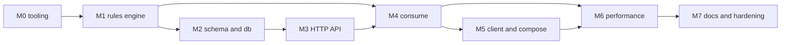

## 7. Important implementation patterns

### 7.1 Functional core, imperative shell

The pure part of the code takes values in and returns values out. The shell does I/O and calls the pure part.

| Pure (no I/O, no clock, no mutation) | Shell (talks to the database, HTTP or the clock) |
|---|---|
| `src/domain/*`: `evaluate`, `headroomFor`, `makeRule`, `periods`, `parseUnits`, `addUsage`, `remainingSummary` | `src/consume/consume.ts` (the transaction) |
| `src/consume/decision.ts` (`buildStoredDecision`), `usage-view.ts` (`periodFor`, `buildUsageView`), `fingerprint.ts` | `src/db/*` repositories and `consume-state.ts` |
| `src/db/usage.ts` `toUsagePair` (a `reduce` over counter rows) and `src/db/plans.ts` `isVisibleTo` | `src/http/routes/*` |
| `client/http.ts` `backoffDelayMs` and `isRetryable`, `client/documents.ts` text builders | `client/http.ts` `createHttp` (does the `fetch`) |
| `load-tests/verify.ts` `findProblems` | `load-tests/verify.ts` `main` |

Purity inside `src/domain` is now **machine-checked**: the owner's ESLint config forbids database, framework, `zod`, `node:*` and consume imports, `Date.now()`, `Math.random()`, a
zero-argument `new Date()` and classes. The owner's test run showed the rule firing on a throwaway file (a restricted `pg` import and `Date.now` both reported, exit code 1).
That proves the rule works for those patterns, not that no other impurity is possible.

### 7.2 `Result` values and exceptions

The project's `Result` (in `src/shared/result.ts`, pasted by the owner) is a union of `{ type: "ok", value }` and `{ type: "err", error }`, with `ok`, `err`,
`mapResult`, `andThen` and `match`. The rule of thumb:

- **Expected outcomes are values.** `parseUnits` returns a `Result`, repositories return one for "already exists" or "plan not found", and `consume()` returns one for
  `user_not_found` and `idempotency_conflict`.
- **Unexpected failures throw.** A database error propagates to the central error handler, which answers a generic `500 internal_error`.
- **Routes translate** a `Result` error into an `AppError` (a thrown error with a status and a code), so the HTTP mapping lives in one place.

Two details worth knowing. Callers branch on `.type`. The tests and `routes/account.ts` contain a redundant `!found.type ||` guard (six sites, for example line 113) that
can never be true; it is harmless dead code. And `response.ok` in `client/http.ts` is the `fetch` Response's own flag, unrelated to `Result`.

### 7.3 Discriminated unions and exhaustiveness

`Decision` (`kind: "accepted" | "rejected"`), `ClientError` (`kind: "api" | "network" | "timeout" | "invalid_response"`), and the rule and error code unions are
discriminated unions. `assertNever` in a `default:` branch turns a forgotten case into a compile error. The same idea appears in a `Record<RuleKind, number>`
used for ordering: adding a rule kind without an entry fails the build.

### 7.4 Validation at the boundaries

| Boundary | Mechanism |
|---|---|
| Environment variables | zod schema in `src/config.ts` and `client/config.ts`; the process refuses to start on a bad value |
| HTTP requests | zod schemas in the route files, parsed once by `parseWith`; `parseUnits` for the amount |
| HTTP responses in the client | zod schemas in `client/schemas.ts`; a wrong shape becomes `invalid_response` |
| Database rows | **Not validated.** `pg` generic types (`db.query<Row>`) are assertions that trust the SQL |

The last row is a real limitation of the typing: TypeScript cannot check that a query returns what its row type claims.

### 7.5 Repository boundary

SQL lives in `src/db`, behind small functions that accept a `Queryable` (a pool or a transaction client). Every function that touches tenant data takes `accountId`, so there is no
query that can reach another account. Routes contain no SQL and no business rules. M6 deliberately merged several small queries into larger ones (`consume-state.ts`) for performance,
which trades readability for fewer round trips.

### 7.6 Transactions

`withTransaction` (in `src/db/client.ts`) runs a function on one connection between `BEGIN` and `COMMIT` and rolls back on a thrown error. The consume transaction receives **its own**
client and never uses the pool inside the transaction. Otherwise a pile of transactions waiting for a lock could hold every pooled connection while needing one more to proceed.

### 7.7 Idempotency

Three layers, as confirmed by the owner's pasted `consume.ts` and `consume-state.ts`:

1. `precheck` before the transaction: one lock-free query answers "was this decided before?" and "does the user exist?".
2. `loadConsumeState` inside the transaction, after taking the lock, includes the same lookup, because a duplicate may have committed while this request waited.
3. A unique constraint on `(account_id, request_id)` as the last guard.

```ts
const replayOrConflict = (existing: StoredRequest, fingerprint: string): ConsumeResult =>
  existing.fingerprint === fingerprint
    ? ok({ ...existing.decision, replayed: true })   // same payload: replay the stored answer
    : err("idempotency_conflict");                    // same id, different payload: client bug
```

### 7.8 Concurrency control

- **The lock.** `lockAccountForConsume` runs `SELECT ... FOR UPDATE` on the account's monthly counter row. Everything that follows runs alone for that account. Only the first request of a
  month finds no row, creates it with `ON CONFLICT DO NOTHING` and locks it.
- **The snapshot rule.** The lock is a statement of its own, and the state read starts after it, so it sees the previous holder's commit. A single combined statement would read an older snapshot.
- **The limiter.** `keyed-limiter.ts` allows at most `ACCOUNT_CONCURRENCY` (default 2, confirmed by the owner's `grep`) consume calls per account in flight inside one process. A finishing task hands its slot
  directly to the next waiter:

  ```ts
  const release = (key: string, slot: Slot): void => {
    const next = slot.waiting.shift();
    if (next !== undefined) {
      next(); // hand this slot straight to the next waiter: `active` stays the same
      return;
    }
    slot.active -= 1;
    if (slot.active === 0) {
      slots.delete(key); // no memory kept for idle keys
    }
  };
  ```

  The limiter wraps the **whole** consume call, including the lock-free precheck, so even a replay or an unknown-user answer waits in the account's queue. It is an optimization. Correctness comes from the database lock, which
  is why it would stay correct with several service instances.

### 7.9 Dependency injection by parameters

Nothing important is created inside the function that uses it: `buildApp(deps)` receives the pool, the admin token, a clock and the limiter setting; the HTTP client receives `fetch`, `sleep` and `random`; `consume()` receives the
limiter as a function. Routes and hooks are built by functions that close over their dependencies (`consumeRoutes(deps)`, `requireApiKey(pool)`). This is what lets tests inject a fixed clock, a scripted `fetch`, or an isolated database schema.

### 7.10 Typed client errors and the retry policy

`client/http.ts` never throws: every failure is a `ClientError`. A pure function `isRetryable` retries only network errors, timeouts, 429 and 5xx, with exponential backoff and full jitter (`backoffDelayMs`),
and only for calls marked retry-safe (reads, idempotent `PUT`s and `/consume`; not `POST /users` or `POST /plans`). The request id is created once, outside the retry loop.

### 7.11 Keyset pagination

History uses `(created_at, id) < (cursor)` with the timestamp carried as PostgreSQL text so microseconds survive. The history query fetches `limit + 1` rows to know whether another page exists.

---

## 8. Testing strategy

### 8.1 The layers

Counts come from the owner's pasted runs. The three files added in M6 have counts from the drafts; their sum matches the reported total (186 tests before M6, 199 after).

| Layer | Where | What it catches | What it cannot catch |
|---|---|---|---|
| Unit tests of pure code | `src/domain/*.test.ts` (evaluate 15, units 10, periods 5, usage 3), `src/consume/*.test.ts` (decision 3, usage-view 5, fingerprint 2, keyed-limiter 5), `src/shared/fp.test.ts` (5), `src/config.test.ts` (5) | Wrong rule logic, boundaries, ordering, config mistakes | Anything involving the database or HTTP |
| Property-based tests | `src/domain/evaluate.property.test.ts` (4) | Cases nobody thought of: the engine accepts exactly when both levels have headroom, is deterministic and non-mutating, reports only real shortfalls, and is monotonic | The same blind spots as unit tests |
| Database integration | `tests/db/migrate.test.ts` (5), `seed.test.ts` (5), `constraints.test.ts` (12) | Schema constraints, migration safety, seed repeatability | Concurrency, the HTTP layer |
| API tests | `tests/http/*.test.ts`: auth 10, accounts 7, users 8, plans 16, isolation 6, consume 30 | Authentication, isolation, validation, plan rules, decisions, rollover, retries, history, with a real database and real routes (`app.inject`, no network port) | Docker, real networking, the browser |
| Concurrency | `tests/http/consume-concurrency.test.ts` (3) | Overspend under parallel requests, 25 identical simultaneous requests, totals that disagree | See 8.3 |
| Client tests | `tests/client/*.test.ts` (config 4, http 15, metering-client 5) | Retry and timeout rules, headers, response validation, with a scripted `fetch` and no network | Real network behavior |
| End to end | `tests/e2e/demo.test.ts` (3) | The real client against the real service over HTTP, including a response dropped on purpose and retried | Docker and the browser |
| Verifier unit tests | `tests/load/verify.test.ts` (7) | The pure `findProblems` function that judges consistency | The SQL query itself |
| Stack smoke test | `scripts/smoke.sh` | The running stack answers `ready` and the scripted scenario passes | Not part of `npm test` |
| Load tests | `load-tests/*.js`, `scripts/load.sh` | Behavior and consistency under load | See section 9: mostly not run |
| Consistency checks | `tests/helpers/consistency.ts` (in tests), `load-tests/verify.ts` (after load runs) | The account counter, the sum of user counters and the sum of accepted requests disagreeing, or exceeding an allowance | |

`tests/smoke.test.ts` is **not** the stack smoke test: it is the M0 test that asserts `1 + 1`. `scripts/smoke.sh` is the one that checks the running stack.

### 8.2 Test isolation and fakes

- **A PostgreSQL schema per test file** (`tests/helpers/test-db.ts`): files run in parallel and never touch each other or real data. It needs `TEST_DATABASE_URL` or the default port.
- **A fixed or movable clock** (`createTestApp({ clock })`, `mutableClock`): month and day rollover are tested exactly.
- **A scripted `fetch`** (`tests/helpers/http-stub.ts`): retries are tested without waiting.

### 8.3 What the concurrency tests really test

`createTestApp` calls `buildApp`, which builds the limiter with its default of 2 (confirmed by the owner's pasted test file: it passes only a clock). So the tests run **through the limiter**: at most two requests per
account are inside the transaction at once. They still prove no overspend and consistent totals, but they do not stress the database lock alone with many simultaneous transactions. A test with a very high
`accountConcurrency` would. It does not exist (Not verified).

The concurrency tests first failed on three assertions, and every failure was a bug in the **test**: an exact match against an object with extra fields, and a comparison of `JSON.stringify` output, where a replayed decision came back from
PostgreSQL `jsonb` with its keys in a different order. The fix compared fields, not serialization.

### 8.4 What a green run does and does not prove

Owner-reported: 27 test files and 199 tests passed, and the static checks passed (`typecheck`, `lint`, `format:check` after formatting, and type-checking under the build config). That is strong evidence for the logic and the API contract. It is not evidence that:
the Docker images build from a clean checkout (the root `Dockerfile` is first committed in M7), the browser page works (reported by the owner as a summary only), the system performs under load (section 9), or a deployed environment behaves
the same. Gaps worth knowing: no test forces the unique-constraint path, none runs two service instances, none tests a month boundary under concurrency, and the lint purity rule has one manual proof.

---

## 9. Performance engineering

### 9.1 Why one account is special

Every consume for an account locks the same row, so that account's requests run one after another. The throughput ceiling is roughly one divided by the time the lock is held (the lock statement, one read statement, one write statement and the commit). Different accounts lock different rows
and never wait for each other. The load tests were designed to show exactly this, and to check whether a hot account slows quiet ones through the shared connection pool.

### 9.2 The setup

All from the repository's file list and the drafted code (`docker-compose.perf.yml` and the k6 scripts were rewritten as whole files in `71542f3`; the nature of that change is not shown).

| Piece | Purpose |
|---|---|
| `docker-compose.perf.yml` | An overlay (not in the normal stack): `pg_stat_statements` and I/O timing in PostgreSQL, `DB_POOL_MAX` and `ACCOUNT_CONCURRENCY` passed to the service, and a k6 container in an opt-in profile |
| `load-tests/lib.js` | Shared helpers: account setup through the real API, the request under test, thresholds, a summary writer |
| `hot-account.js` / `many-accounts.js` | One account versus many: the worst and best case for the lock |
| `retry-storm.js` | Concurrent duplicates of one request id; exactly one may be the original |
| `tight-limit.js` | Demand far above a small allowance; accepted units must equal the allowance exactly |
| `noisy-neighbor.js` | A hot account plus quiet accounts at a steady rate; are the quiet ones slowed? |
| `load-tests/verify.ts` | After every run: for each account the run created, the account counter, the sum of user counters and the sum of accepted requests must be equal and within the allowance |
| `load-tests/sql/diagnose.sql` | Wait events during a run, heaviest statements, table health, and an `EXPLAIN` of the history query |
| `scripts/load.sh` | Starts the stack with the overlay, runs k6, runs the verifier, saves the top statements |

**Connection pool.** `DB_POOL_MAX` (default 10). With a hot account, requests waiting for its lock hold connections, so a pool can drain. The limiter keeps most waiting requests in memory instead. Whether 2 is the right default
was **never measured**.

### 9.3 The only measurement that exists

A 10-second rehearsal of `hot-account` (10 virtual users, one account) on the final code, from `load-tests/results/check-hot-account.json` and its statements file (Reported by owner):

| Metric | Value |
|---|---|
| Consume requests | 2,456 (about 245.6 per second over the configured duration) |
| Latency (ms): avg, p50, p90, p95, p99, max | 40.6, 39.8, 44.7, 46.8, 56.9, 76.1 |
| HTTP failures, failed checks, unexpected rejections | 0, 0, 0 |

| Statement (from `pg_stat_statements`) | Calls | Mean ms | Total ms |
|---|---|---|---|
| The lock statement (`SELECT ... FROM account_usage ... FOR UPDATE`) | 2,458 | 2.485 | 6,109 |
| The state read | 2,456 | 0.430 | 1,057 |
| The lock-free precheck | 2,456 | 0.316 | 775 |
| The combined record statement | 2,456 | 0.249 | 613 |
| API key lookup | 2,509 | 0.037 | 93 |
| Foreign-key check on `requests` | 2,456 | 0.014 | 34 |

Which statement is which is inferred from the query text and the call counts. Reading the numbers (arithmetic, not a comparison):

- Average latency is almost exactly users divided by throughput: 10 / 245.6 per second is about 40.7 ms, against 40.6 ms reported. The one account served about one request every 4 ms, and the other requests waited in line.
- The lock statement has the largest mean (2.49 ms) because its time includes waiting for the previous holder, so it measures serialization.
- The six statements together average about 3.5 ms per request, so most of the 40 ms is waiting, not database work.
- The two extra lock calls and the two calls of the counter-row insert (mean 6.1 ms) are the first requests of the month racing to create the counter row, exactly the case that `ON CONFLICT DO NOTHING` handles.
- The composite foreign key check costs about 0.014 ms per request.

### 9.4 What is not established

This is **one run on one machine on the final code**. There is no baseline to compare it with, so nothing here shows that the M6 optimizations improved anything. Not measured: the baseline on the pre-M6 code, `many-accounts`,
`noisy-neighbor` (the question "does a hot account hurt quiet ones?" is open), the limiter at other values, pool sizes, wait-event samples, and the `retry-storm` and `tight-limit` correctness scenarios on the final code. `docs/performance.md` is
still the blank template. A cheap way to get a baseline exists: the unmerged branch `feat/load-testing` holds the load tooling on the pre-optimization code (it would need a root `Dockerfile`, which that branch lacks).

---

## 10. Trade-offs and failure scenarios

### 10.1 Trade-offs

| Topic | Choice | Benefit | Cost |
|---|---|---|---|
| Consistency | One row lock per account, default isolation | Correct shared allowance, no deadlocks | A per-account throughput ceiling |
| Retries | Replay the stored decision | Predictable, safe retries | A retry after a plan change still gets the old answer |
| Rejections | HTTP 200 with `accepted: false` | One field to branch on | Clients that expect 4xx for rejection must adapt |
| Persistence | Everything in PostgreSQL | Survives restarts | History and counters grow forever |
| Round trips | Merged SQL statements | Shorter lock hold | Larger SQL strings, harder to read |
| Limiter | In-process per account | Protects the pool | Per instance only; adds waiting for replays too |
| Time | UTC, one timestamp per request | Exact, testable periods | No per-account time zones |
| Authentication | Hashed keys, one admin token | No stored secrets | No rotation endpoint, no roles |
| Configuration | Environment variables validated at start | Fail fast | Compose ships a default admin token (documented as dev-only) |
| Operations | Overlay for performance | Normal stack stays simple | A second compose file to maintain |

### 10.2 Failure scenarios

"Confirmed" means shown by an owner-reported test or output. "Design" means it follows from the drafted code. "Theoretical" means reasoned only.

| Scenario | What happens | Status |
|---|---|---|
| The server crashes mid-transaction | The transaction rolls back, nothing is counted. The retry is decided normally | Design |
| The commit succeeded but the response was lost | The retry is replayed from the stored decision | Confirmed (end-to-end test drops a response on purpose) |
| 25 identical requests at once | One original, 24 replays, counted once | Confirmed (concurrency test, run through the limiter) |
| Two first-of-the-month requests race to create the counter row | `ON CONFLICT DO NOTHING`, then both lock it | Confirmed by the extra lock calls in the rehearsal statements |
| A plan is edited while a request is deciding | The request uses the plan its state statement read; later requests see the new one. A plan edit is atomic | Design |
| A request waits for the limiter across midnight UTC | It keeps its arrival-time period, because the timestamp is taken before waiting | Design |
| Requests straddle a month boundary | They lock different counter rows, so they can run concurrently without sharing counters | Theoretical |
| Two instances with clock skew near a boundary | They might assign different months to near-simultaneous requests | Theoretical |
| The database is down | `/ready` returns 503; a consume throws, becomes 500, and the client retries it safely | Design |
| The unique constraint fires | The drafted code does not turn it into a replay; the lock is what prevents it; it would surface as a 500 | Theoretical |
| The API key leaks | No rotation endpoint; revocation only through the database | Design |
| Replayed JSON has different key order | Same data, different serialization | Confirmed (test failure fixed) |

---

## 11. Limitations and possible improvements

### 11.1 Known limitations

- No key rotation or revocation endpoint, one shared provisioning secret, no roles.
- No deletion or deactivation of accounts, users or plans.
- No rate limiting and no backpressure; waiting requests queue in memory.
- The limiter is per process. Only one service instance was ever considered.
- A hot account is bounded by its lock hold time.
- History, counters and idempotency records are never archived.
- Rejected requests are recorded, so they cost a write.
- UTC only, one resource only.
- Database row types are trusted, not validated.
- The `tsconfig.json` uses `strict` only, and `npm run typecheck` covers `src` and `tests` (the client entry files are covered by the build config).
- The demo shares one in-memory session and has no login.

### 11.2 Unverified behavior

Performance (section 9.4); that the browser demo behaves as described beyond the owner's summary; the limiter-free lock under many simultaneous transactions; behavior with several instances; the unique-violation path; the contents of `docs/Schema.png`.

### 11.3 Housekeeping seen in the repository (as of the evidence)

These are not architecture. They should be fixed or removed before the final version of this document.

- Eleven compiled `.js` files are tracked beside their sources under `src/`, and a `Zone.Identifier` file under `docs/`.
- The branches `feat/lea`, `feat/loa` and `feat/load-testing` are stale or unmerged.
- The root `Dockerfile` first appears in the M7 commit, so the M5 merge (tagged `perf-baseline`) cannot build the service image from a clean checkout.
- `@types/node` is `^26.6.5` while `engines` requires Node `>=22` and the images use `node:22-alpine`.
- Six `!found.type ||` guards in `routes/account.ts` are dead conditions.
- No `v1.0` tag; the M7 commit mixes documentation, lint, cleanup and a Dockerfile under a performance message.
- `docs/endpoints.md` is incomplete and partly wrong; `docs/performance.md` is a blank template.
- Three `PROJECT_WALKTHROUGH_Part*.md` files and `docs/USER_GUIDE.md` are untracked.

### 11.4 Possible improvements (out of current scope)

Key rotation and revocation endpoints; user deactivation; rate limiting or a bounded queue with a "busy" answer; multi-instance load tests; archiving old history; per-account time zones; stricter compiler flags
(`noUncheckedIndexedAccess`); runtime validation of database rows; a test for the limiter-free lock; an idempotency-record expiry; request ids in logs; an OpenAPI description.

---

## 12. Final mental model and learning outcomes

### 12.1 The system in one paragraph

A caller sends an API key, a user, a request id and an amount. The API turns the key into an account, validates the input, and waits for one of two per-account slots. A lock-free query checks for a previous decision and the user. A
transaction then locks the account's monthly counter row, reads both plans and the four counters in one statement, asks the pure rules engine for a decision, and records the decision and (if accepted) the counters in one statement. The answer
says what happened and what is left. A retry with the same request id gets the stored answer. Everything lives in PostgreSQL, and the schema itself refuses many mistakes.

### 12.2 Milestone dependencies



*Diagram not rendered by the author; preview it before relying on it.*

### 12.3 Study checklist

| Layer | Be able to explain |
|---|---|
| Domain | Headroom; why usage is passed in; the fixed violation order |
| Database | Composite foreign keys; counters by owner and period; checksums and the advisory lock; keyset pagination |
| Consume flow | The three idempotency layers; why the lock is its own statement; why the state read follows it |
| HTTP | Hooks before parsing; the account id coming only from the key; one error format |
| Client | Three layers; which calls retry; the request id created once |
| Tests | What each layer catches; why the concurrency tests run through the limiter |
| Performance | Why a hot account has a ceiling; what was and was not measured |

### 12.4 Problems we hit, and what they taught

These happened during development (from the conversation and the owner's pasted outputs).

| Problem | What happened | Lesson |
|---|---|---|
| `Missing script: "format"` | Prettier scripts did not exist until M3 (`a6e3ced`), and one commit then reformatted 53 files | Set up lint and formatting in M0 |
| `format:check` failed on five files | Pasted code used a wider line width than the project's Prettier default | Run the formatter after pasting code |
| `password authentication failed` | A PostgreSQL 18 server installed inside WSL listened on `127.0.0.1:5432` and answered before the container | Test credentials from inside the container (`docker compose exec ... psql`) to separate networking from authentication, and check what owns the port (`ss -ltnp`, `ps`) |
| `ECONNREFUSED` after moving to port 5433 | `.env` did not exist, so `sed -i` changed nothing and Compose used its defaults. Later, Docker was not visible in the WSL distro | "Refused" means nothing is listening; "authentication failed" means something is. Check the file exists |
| An exported variable vanished | `TEST_DATABASE_URL` lasted only one terminal session | Put durable settings in a shell profile or `.env` |
| `EACCES` when building | `dist/` was owned by root from an earlier `sudo` | Never build with `sudo` |
| Concurrency test failures | Test assertions were too strict, and compared JSON text instead of data (`jsonb` reorders keys) | Compare data, not serialization |
| A client file used `.ok` but `Result` uses `.type` | `npm run typecheck` does not include `client/`, so only the build or the Docker image revealed it | Type-check everything that ships |
| Compiled `.js` files committed | A `tsc` run emitted JavaScript beside the sources, from the first commit on | Ignore build output, and read `git status` before committing |
| The M5 tag cannot build the service | The root `Dockerfile` was committed only in M7 | A fresh-clone test would have caught it |
| One huge final commit | M7 bundled many unrelated changes under one message | Small commits keep history readable |

### 12.5 Self-check, with answers

1. **Why are usage rules separated from HTTP routes?** The rules are the product's heart. As a pure function they run in milliseconds with thousands of generated inputs and no database, and routes stay about HTTP. A rule change then cannot break authentication or SQL.
2. **Why does the system need idempotency?** Networks lose responses. Without a request id a retry would count twice. The id plus a stored decision makes a retry return the same answer, and the fingerprint catches a reused id with a different payload.
3. **Why does account-level concurrency matter?** The account allowance is shared, so two simultaneous requests could both see "5 left". One row lock per account serializes decisions, and the read after the lock sees the previous commit.
4. **Why are UTC periods important?** Months and days must mean the same thing on every machine. One UTC timestamp per request, stored as the month on the request, makes rollover exact and testable with a fake clock.
5. **Why do constraints and transactions matter?** A transaction makes "record the decision and update the counters" all or nothing. Constraints keep wrong data out even if a query has a bug (a user plan on an account, another account's user on a request, a changed predefined plan).
6. **How do the client, API and database interact?** The client sends HTTP with an API key and a request id. The API authenticates, validates and calls the consume flow, which uses SQL. The client parses responses with zod and retries safe calls with the same id.
7. **What does the consistency verifier protect against?** Speed changes silently breaking accounting. It compares the account counter, the sum of user counters and the sum of accepted requests, and checks nothing exceeds the allowance.

### 12.6 The two-minute pitch

"It is a metering service. An application asks it whether a user may consume N units, and it applies two plans together: a shared account allowance and the user's own. The decision is a pure function, tested with
property-based tests, so the rules are separate from SQL and HTTP. The API is Fastify with zod validation, hashed API keys and account isolation by construction. Consume runs in one transaction under a row lock on the account's monthly counter,
reads plans and counters in one statement after the lock, and records the decision and counters in one statement. A request id makes retries safe, so a lost response is replayed, not recounted. PostgreSQL enforces what it can: composite
foreign keys, read-only predefined plans, checksummed migrations. There is a typed client with safe retries, a browser demo, and a Docker Compose stack. I built k6 load tests with a consistency check, but I only ran a short rehearsal, so I can say
how the design behaves but not how much M6 improved it."

---

## 13. How to extend and debug

### 13.1 Add a new rule kind (for example `max_per_hour`)

| Step | File | Why |
|---|---|---|
| Add the kind to `RULE_KINDS` | `src/domain/types.ts` | The compiler then flags every place that must handle it |
| Define its headroom and its "used" value | `src/domain/rules.ts` (`headroomFor`, `usedFor`) | The only place rule semantics live |
| Give it an order | `src/domain/evaluate.ts` (`RULE_ORDER` record) | Violations need a fixed position |
| Show its remaining amount | `src/domain/usage.ts` (`remainingSummary`) | It appears in every response |
| Store its counters | A **new** migration (`0003_...`): the `plan_rules.kind` and `period_kind` checks name the allowed values in `0001`, which must never be edited; new counter rows or a new period kind | Applied migrations are checksummed |
| Read and write the counters | `src/db/consume-state.ts` (`STATE_SQL`, `RECORD_SQL`) | The consume statements list the counters |
| Accept it in plans | The plan schema in `src/http/routes/account.ts` (uses `RULE_KINDS` in the drafted code) and `client/schemas.ts` | Validation on both sides |
| Test it | `evaluate.test.ts`, the property test's arbitraries, an API test in `consume.test.ts` | The new rule must compose with the others |
| Document it | README rules section, `docs/endpoints.md` | |

### 13.2 Add an endpoint

Write the zod schema and the route in the matching file under `src/http/routes/`, put the SQL in a repository function that takes `accountId`, return a DTO from `src/http/dto.ts`, add an isolation test (another account must get 404), and add it to the
README and `docs/endpoints.md`.

### 13.3 Add a migration

Create the next numbered file in `migrations/` (never edit an applied one). `tests/db/migrate.test.ts` computes the expected versions from the files on disk, so it keeps working. Run the full test suite, which migrates a fresh schema per test file.

### 13.4 Symptom to location

| Symptom | Look at |
|---|---|
| 401 on every call | `src/http/auth.ts`, `src/db/accounts.ts` (`findAccountByApiKeyHash`); is the key revoked or mistyped? |
| `user_not_found` unexpectedly | `precheck` in `src/db/consume-state.ts`; the user must exist in **this** account (`externalId`) |
| 409 `idempotency_conflict` | `src/consume/fingerprint.ts`; the same request id with a different user or amount |
| A request is rejected and you do not know why | The `reason` in the answer, or `GET /history?outcome=rejected`: it stores the plans and violations at that time. Then `GET /users/:externalId/effective-plans` |
| Counters look wrong | `load-tests/verify.ts` or `tests/helpers/consistency.ts`: compare the account counter, the sum of user counters and accepted requests |
| A plan change seems ignored | `updateCustomPlan` in `src/db/plans.ts`, and remember a retry replays the old decision |
| Slow under load | `load-tests/sql/diagnose.sql` (wait events: `Lock`, `WALSync`, `Client`), `ACCOUNT_CONCURRENCY`, `DB_POOL_MAX` |
| Service will not start | `docker compose logs service`: migrations (`src/db/migrate.ts`), configuration (`src/config.ts`) |
| Demo shows something odd | `client/scenario.ts`, `client/web/page.ts`, and the in-memory session in `client/server.ts` |

### 13.5 A debugging recipe for a consume problem

1. Reproduce with `curl` and a fresh request id.
2. Look at the answer's `reason`, `plans` and `remaining`.
3. Read `/history` to see the stored decision, and `/users/:externalId/usage` for the counters.
4. Run the consistency check on the account's month.
5. If it is a concurrency issue, set `ACCOUNT_CONCURRENCY` high in a test and look at wait events.

---

## Part 4 verification status

| Claim or check | Evidence | Status |
|---|---|---|
| `typecheck`, `lint`, `format:check` pass; type-checking under the build config passes | Owner's pasted outputs | Reported by owner |
| The purity lint rule fires on a restricted import and `Date.now` | Owner's pasted ESLint output with exit code 1 | Reported by owner |
| 27 files and 199 tests passed | Owner's pasted summary | Reported by owner |
| Per-file test counts | Owner's pasted runs for M0 to M5; drafts for `keyed-limiter`, `verify` and `config` (sum matches 199) | Reported by owner (M0 to M5), Expected from source (the three M6 files) |
| `Result` shape and the `!found.type` guards | Owner's pasted `result.ts` and grep | Reported by owner |
| `consume.ts`, `consume-state.ts`, `keyed-limiter.ts`, `config.ts` contents | Owner's pasted files | Reported by owner |
| Limiter default of 2 | Owner's pasted `grep` and `config.ts` | Reported by owner |
| The concurrency tests run through the limiter at its default | Owner's pasted test header (a clock only) plus `consume.ts` | Expected from source |
| Rehearsal numbers and statement times | Owner's pasted JSON and statements file | Reported by owner |
| Which statement is which in the table | Inferred from query text and call counts | Expected from source |
| Overlay and k6 script contents | Drafts; each was rewritten as a whole file in `71542f3` | Expected from source |
| Failure scenarios marked "Design" | Follow from the pasted flow | Expected from source |
| Docker stack and browser demo worked | Owner's "all pass", no outputs | Reported by owner (summary only) |
| Any baseline comparison, the limiter value, pool sizing, `noisy-neighbor`, `retry-storm` and `tight-limit` on the final code | No measurements | Not verified |
| A test of the lock without the limiter, a unique-violation test, a multi-instance test | None exists | Not verified |
| `docs/Schema.png` contents | Not supplied | Not verified |
| Mermaid diagrams render | Not rendered | Not verified |